# 通用批处理流水线模板 · 系统设计文档

| 项目 | 内容 |
|---|---|
| 文档名称 | 通用批处理流水线模板（Java）系统设计说明书 |
| 版本 | v1.0 |
| 日期 | 2026-10-31 |
| 状态 | 已实现并通过验证 |
| 运行环境 | JDK 8+（代码按 Java 8 兼容语法编写，JDK 20 实测通过） |
| 第三方依赖 | 无（纯 JDK） |
| 源码规模 | 19 个 Java 文件 / 约 1590 行 |

---

## 1. 项目概述

### 1.1 背景与目标

业务侧存在一类**"有终点、有大批量数据"**的批处理任务：从一个数据源（文件）顺序读取记录，按固定批量调用远端 HTTP 接口逐批处理，最终把处理结果（原始记录 + 处理结果状态码 + 服务端返回的附加内容）落成一个统一的输出文件。

这类任务的共性痛点：

1. **串行处理太慢**，需要多消费者并发；
2. **不能无限预读**，否则内存随文件大小线性膨胀、失败时难以收拾；
3. **失败必须可区分**：服务端明确的业务失败 vs 整批调用失败，处理方式完全不同；
4. **每种文件格式/接口的输出格式都不一样**，重复造轮子成本高。

因此本项目的目标是：**把批处理中"不变的部分"（并发、背压、落盘、合并、容错、统计）沉淀成通用内核，把"变化的部分"（读取、调用、格式化）抽象成 SPI 接口**，使不同文件类型的批处理任务只需提供三个业务实现即可复用同一套运行时。

### 1.2 核心特性

| 特性 | 说明 |
|---|---|
| 批次级传输 | 传输单元是"批次"（默认 100 条），而非单条记录 |
| 严格背压 | 信号量控制在途批次数，消费者忙且缓冲占满时生产者停止读取 |
| 可配并发 | `consumerThreads`(N) + `bufferBatches`(B)，在途上限 = N + B |
| 失败可区分 | 记录级失败（RECORD）与批次级失败（BATCH）分流记录，带级别列 |
| 数据不丢 | 任何路径下「输入行数 = 输出成功行数 + 错误行数」 |
| 原子落地 | 先写 `*.tmp` 再 rename，下游不会读到半截文件 |
| 优雅停止 | 异常/中断时停在安全边界：在途批次跑完、不覆盖旧产出、保留分片现场 |
| 零依赖 | 纯 JDK 并发工具，可直接 `javac` 编译运行 |

### 1.3 非目标（Out of Scope）

- **不实现具体的 HTTP 调用**：由使用方在 `BatchProcessor` 中实现；
- **不实现具体的数据解析/输出格式**：由使用方的 `RecordReader` / `LineFormatter` 决定；
- **不内置进程级断点续跑**：停止时保留 `parts/` 分片以支持外部实现，当前版本未内置自动续跑；
- **不做分布式**：单机多线程模型，不涉及跨节点协调。

---

## 2. 需求规格

### 2.1 功能性需求

| 编号 | 需求 | 实现位置 | 状态 |
|---|---|---|---|
| FR-1 | 采用生产者消费者模式 | `FileBatchPipeline` + `BatchTask` | 已实现 |
| FR-2 | 生产者负责读取文件并累计成批 | `BatchProducer`（生产者线程） | 已实现 |
| FR-3 | 每累计 100 条做一次批处理 | `batchSize` 参数 + 尾批提交 | 已实现 |
| FR-4 | 生产者约一个线程；消费者支持多线程，线程数可配 | `Thread(batach-producer)` + `ThreadPoolExecutor(N)` | 已实现 |
| FR-5 | 无闲置空间时生产者停止生产（背压） | `Semaphore(N+B)`，`acquirePermit()` | 已实现 |
| FR-6 | 缓冲位数可配置 | `bufferBatches` 参数 | 已实现 |
| FR-7 | 读取源可替换（通用接口） | `RecordReader` SPI + `RecordReaders` 适配器 | 已实现 |
| FR-8 | 调用 HTTP 接口做批处理 | `BatchProcessor` SPI | 已实现（Demo 为模拟） |
| FR-9 | 记录每条记录的处理结果状态码 | `ItemResult`（status/code/payload/message） | 已实现 |
| FR-10 | 批次失败/记录失败均落盘，且用不同级别区分 | 错误文件 `RECORD`/`BATCH` 级别列 | 已实现 |
| FR-11 | 成功与失败分流到两个独立输出文件 | `PartWriter` 双分片 + `OutputMerger` 双合并 | 已实现 |
| FR-12 | 所有批次结果最终合并成统一输出文件 | `OutputMerger`（按序号升序流式合并） | 已实现 |
| FR-13 | 输出格式按文件类型可替换 | `LineFormatter` SPI | 已实现 |
| FR-14 | 失败后继续处理后续批次（不 fail-fast） | `BatchTask.handleBatchFailed()` | 已实现 |
| FR-15 | 读取异常时终止整个流程 | `abort()` + 生产者 catch Throwable | 已实现 |
| FR-16 | 结束时输出统计汇总 | `PipelineStats.printSummary()` | 已实现 |

### 2.2 非功能性需求

| 编号 | 需求 | 设计对策 | 验证 |
|---|---|---|---|
| NFR-1 | 内存占用与文件大小无关 | 在途上限 M 固定，最坏驻留 (N+B)×batchSize 条 | 上界可证 |
| NFR-2 | 数据零丢失 | 三条守恒校验 + 失败必落盘 + 兜底失效即停止 | 已验证 |
| NFR-3 | 输出文件原子可见 | `write tmp → ATOMIC_MOVE rename` | 已实现 |
| NFR-4 | 失败可诊断 | 分片保留、错误码分布统计、批次序号溯源 | 已验证 |
| NFR-5 | 可观测 | 统计指标 + 分级日志（含背压提示） | 已实现 |
| NFR-6 | 可移植 | 仅用 JDK 8 API，无第三方依赖 | JDK20 实测 |
| NFR-7 | 可扩展 | 三个 SPI 接口，内核零业务耦合 | Demo 双实现验证 |
| NFR-8 | 优雅停机 | 支持 JVM 关闭钩子与在途批次等待上限 | 已实现 |

### 2.3 约束与假设

- **假设 1**：数据源是顺序读取的，且由单个线程读取即可满足吞吐（读取速度远快于批处理调用）；
- **假设 2**：批处理接口具备幂等性或允许重跑（本模板不负责去重）；
- **约束 1**：`BatchProcessor` 返回的结果列表必须与输入批次**一一对应、顺序一致**（内核有防御校验）；
- **约束 2**：磁盘需预留约 **2 倍输出文件大小**的空间（分片期 + 合并期峰值）。

---

## 3. 系统架构设计

### 3.1 分层架构

```
┌──────────────────────────────────────────────────────────────┐
│  接入层 / 业务实现层（使用方提供，随文件类型变化）              │
│  RecordReader          BatchProcessor        LineFormatter    │
│  (读取实现)             (HTTP调用实现)         (输出格式实现)   │
└───────────────┬──────────────┬─────────────────┬─────────────┘
                │              │                 │
┌───────────────▼──────────────▼─────────────────▼─────────────┐
│  编排层（Orchestration）                                       │
│  FileBatchPipeline：生命周期、参数装配、停止传播、合并调度        │
└───────────────┬──────────────────────────────────────────────┘
                │
┌───────────────▼──────────────────────────────────────────────┐
│  执行层（Execution）                                           │
│  生产者线程   Semaphore背压   消费者线程池   BatchTask         │
└───────────────┬──────────────────────────────────────────────┘
                │
┌───────────────▼──────────────────────────────────────────────┐
│  存储层（Persistence）                                         │
│  PartWriter（分片写入/分流）    OutputMerger（合并/原子rename） │
└───────────────┬──────────────────────────────────────────────┘
                │
┌───────────────▼──────────────────────────────────────────────┐
│  支撑层（Cross-cutting）                                       │
│  PipelineConfig · PipelineStats · PipelineLog · 异常模型       │
└──────────────────────────────────────────────────────────────┘
```

分层原则：**依赖方向单向向下**，上层可以调用下层，下层不感知上层；接入层通过接口注入，与内核层零编译期耦合。

### 3.2 模块划分

| 模块 | 包名 | 职责 | 是否需改动 |
|---|---|---|---|
| 内核 core | `com.example.batch` | 并发、背压、落盘、合并、统计、停机 | 不需要 |
| 业务实现 demo | `com.example.demo` | 读取/调用/格式化的具体实现 | 替换为生产实现 |

### 3.3 系统架构图

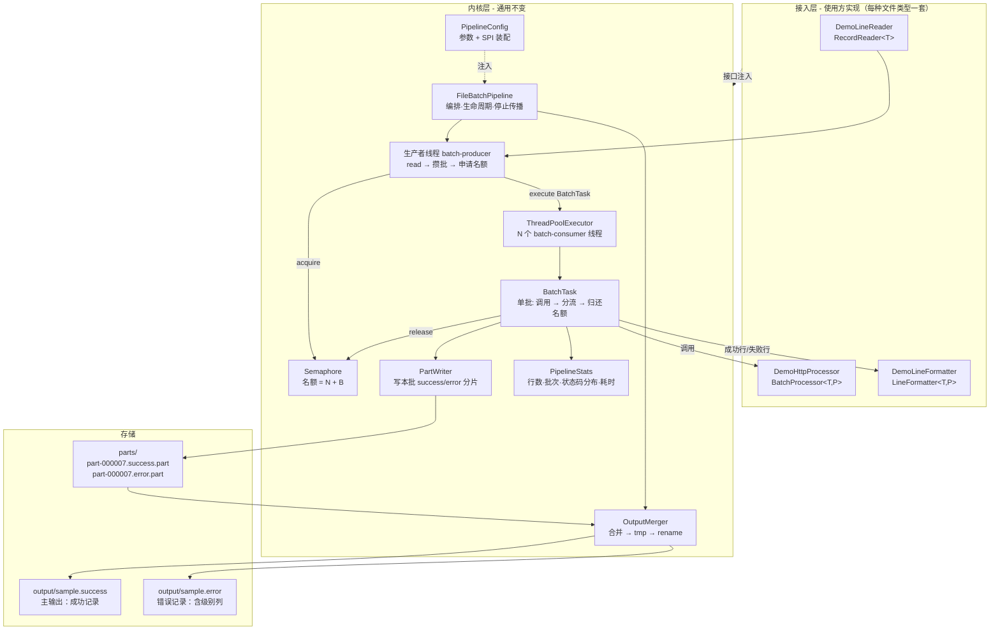

### 3.4 核心类图

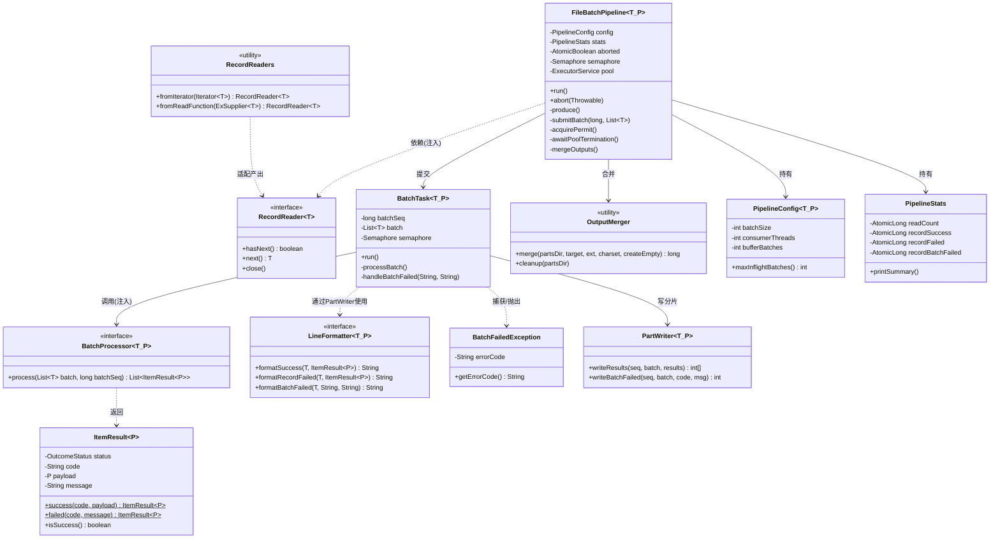

---

## 4. 并发模型设计

### 4.1 线程模型

| 角色 | 线程 | 数量 | 职责 |
|---|---|---|---|
| 生产者 | `batch-producer` | 1 | 顺序读取、攒批、申请名额、提交任务 |
| 消费者 | `batch-consumer-1..N` | N = `consumerThreads` | 执行单批处理：调用 + 分流写入 + 归还名额 |
| 编排者 | 调用线程（main） | 1 | 启动生产者、等待线程池终止、合并、收尾、统计 |
| 守护 | `batch-shutdown-hook` | 0~1 | JVM 关闭时请求优雅停止 |

设计取舍：**生产者不占用线程池名额**，独立单线程运行；调用线程负责收尾，避免额外线程间的状态同步成本。

### 4.2 背压机制（核心）

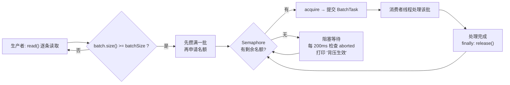

**关键设计点：**

1. **顺序是"先攒满、再申请"**（而非先占名额再读）。若顺序相反，会出现"名额被占但批次还没攒出来"的情况，白白浪费并发度，且在消费者慢时多占名额。
2. **在途上限 M = N + B**，其中 B 是缓冲位数：
   - `B = 0`：严格模式，消费者一空闲必须等生产者现读一批；
   - `B = 1`（推荐）：允许生产者提前攒一批备着，消除等待抖动；
   - `B ≥ 2`：更强的预读，背压反馈变迟钝，仅当读取源本身很慢时才有价值。
3. **等待可中断**：`tryAcquire(200ms)` 循环 + 每轮检查 `aborted`，保证停机指令能在 200ms 内被感知，不会永久阻塞。
4. **名额必定归还**：`BatchTask.run()` 的 `finally` 中 `release()`，无论成功、失败、异常都不会泄漏。这也是本设计不采用"有界队列"的一大原因——队列的弹出与任务完成之间存在窗口，难以精确表达"正在处理的批次数"。

**为什么不用有界队列做背压？**

有界队列限制的是"排队中的批次条数/个数"，它与"正在被处理的批次数"是两个概念：当两个消费者都在忙时，队列未满就意味着生产者仍可继续提交，这与需求「消费者都在工作时不应再生产批次」不符。信号量直接对"在途未完成批次数"建模，语义精确。

### 4.3 内存模型

```
最坏驻留记录数 = maxInflight × batchSize = (N + B) × batchSize
               = (4 + 1) × 100 = 500 条       （Demo 默认配置）
               = (2 + 1) × 100 = 300 条       （文档推荐配置）
```

**该上界与文件大小、消费速度无关**，是一个可由参数证明的常量级占用。

---

## 5. 核心流程设计

### 5.1 主流程（run）

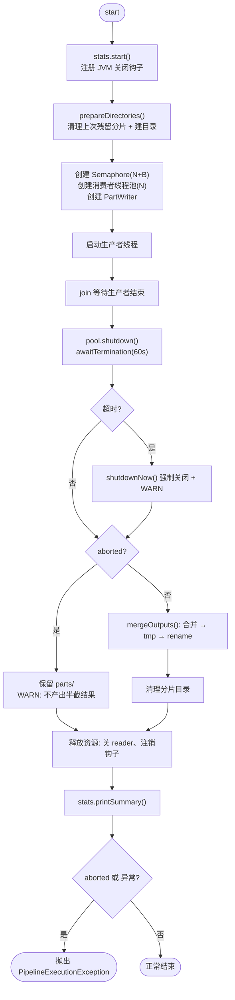

### 5.2 生产者流程

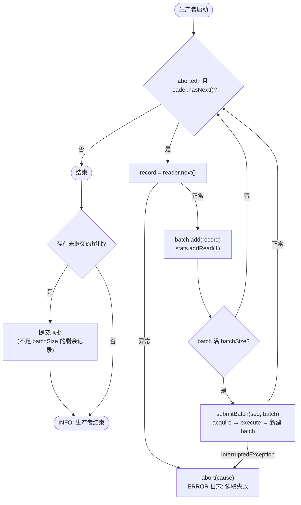

> **尾批处理**：当总记录数不是 `batchSize` 的整数倍时，剩余的不足一批的记录会在循环结束后单独提交，不会丢失。Demo 采用 1050 行输入正是为验证这条路径。

### 5.3 消费者流程（单批 BatchTask）

```mermaid
flowchart TB
    A([消费者取得 BatchTask]) --> B["processor.process(batch, seq)"]
    B -->|"BatchFailedException"| C["handleBatchFailed(errorCode, msg)"]
    B -->|"其他 Exception"| C2["handleBatchFailed('UNKNOWN', msg)"]
    B -->|"正常返回"| D{"results 非空<br/>且 size == batch.size()?"}
    D -- 否 --> C3["handleBatchFailed('BAD_RESPONSE', 条数不符)"]
    D -- 是 --> E["PartWriter 分流写入:<br/>成功 → success 分片<br/>FAILED → error 分片(RECORD)"]
    C --> F["整批写入 error 分片(BATCH)<br/>batchFailed++ · 错误码计数"]
    C2 --> F
    C3 --> F
    E --> G["batchOk++<br/>逐条统计: 成功/失败/状态码分布"]
    F --> Z
    G --> Z
    Z([finally: semaphore.release()])
    Z --> Y([任务结束])
    B -->|"IOException 写分片失败"| X["pipeline.abort()<br/>兜底失效 → 全局停止"]
    B -->|"Error (OOM等)"| X
    X --> Z
```

### 5.4 合并流程

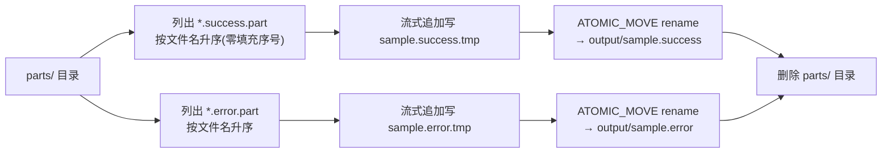

> 由于文件名前缀为 `part-%06d`（零填充），字典序即批次序号，因此**合并结果天然保持输入文件的行序**；这是分片方案的附带收益，无需额外排序。

### 5.5 关键时序图：读取异常导致的全局停止

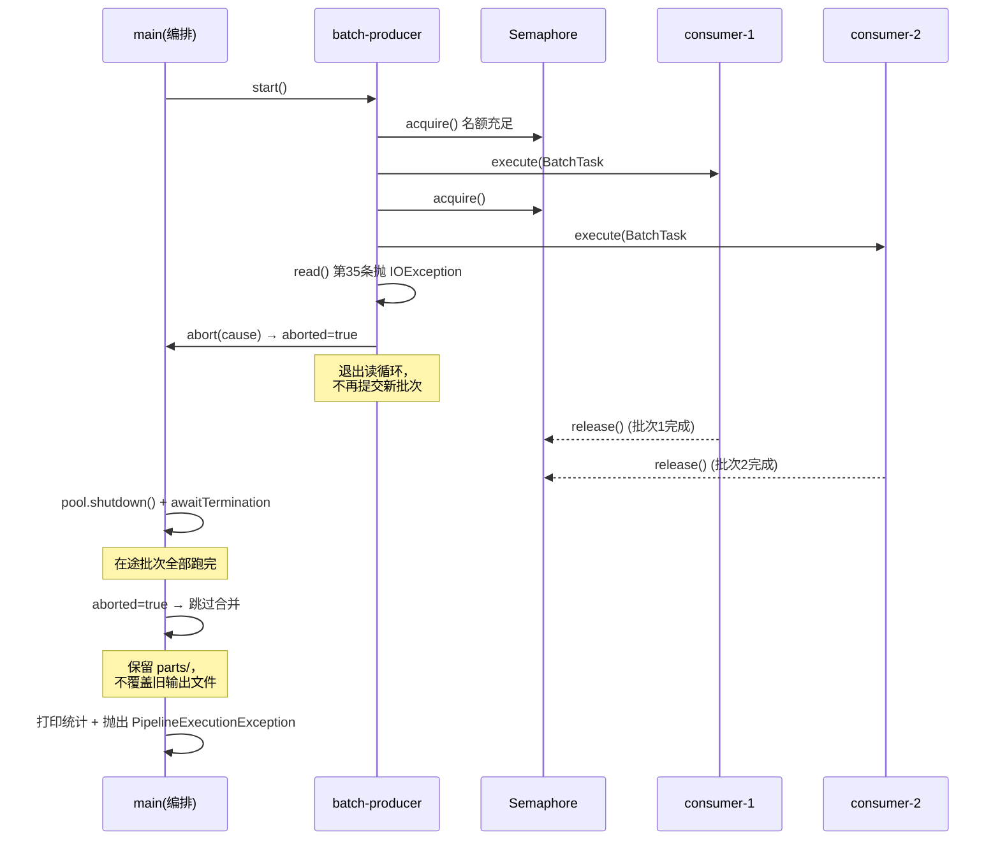

### 5.6 运行状态机

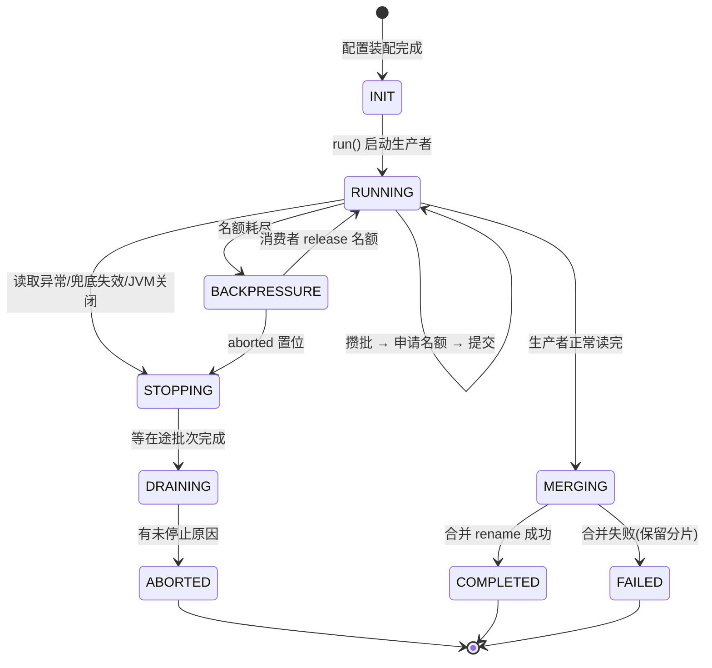

---

## 6. 数据流与存储设计

### 6.1 数据流图

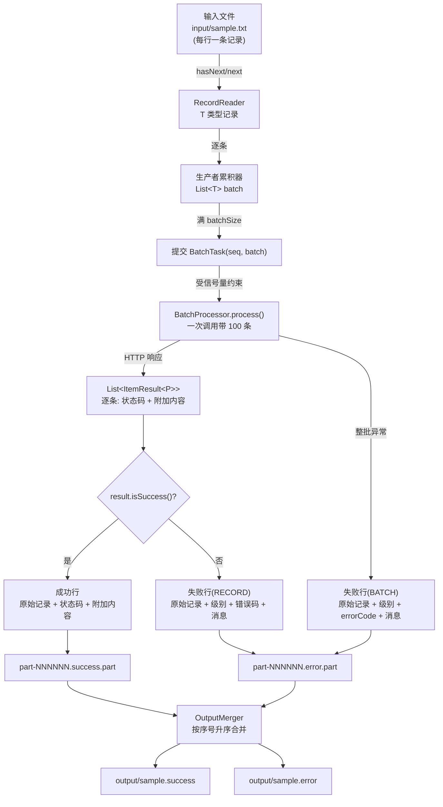

### 6.2 目录与文件命名规范

```
{工作目录}/
├── input/
│   └── sample.txt                     输入文件（使用方提供）
├── parts/                              分片目录（运行中，按通道分子目录）
│   ├── paid/
│   │   ├── part-000001.part            批次1 中落在 paid 通道的记录
│   │   └── part-000011.part
│   ├── shipped/
│   │   └── part-000001.part
│   └── error/
│       └── part-000002.part            失败记录 + 未注册路由兜底
└── output/
    ├── order.paid                      通道 paid 的最终文件
    ├── order.shipped                   通道 shipped 的最终文件
    └── order.error                     错误通道的最终文件
```

命名约定：

| 文件 | 规则 | 目的 |
|---|---|---|
| 通道分片 | `{通道key}/part-%06d.part` | 零填充保证字典序 = 批次序号；按 key 分子目录，合并时扫一个目录即可 |
| 临时输出 | `{目标文件名}.tmp` | 写完后 rename，保证原子可见 |
| 不存在的分片 | 不创建（只有真正有记录时才 openWriter） | "本批该通道无数据" 由此自然可判，无需额外计数 |

**为什么按通道分子目录，而不是 `part-000001.paid.part`**：

1. 合并时按目录扫描，不必解析文件名的通道部分；
2. 通道 key 不必参与文件名转义（`.` `-` 等字符不会与后缀规则冲突）；
3. 排查现场时能直接 `ls parts/paid` 定位。

**通道 key 的字符约束**：`[A-Za-z0-9][A-Za-z0-9._-]{0,47}`。必须 ASCII——中文目录名在
macOS/Linux 正常，但跨 Windows 打包、zip 解压、CI 缓存时经常乱码。业务文案放 formatter。

**分片清理策略**：

- 合并成功 → 删除整个 `parts/` 目录（含各通道子目录，受 `deletePartsOnSuccess` 控制）；
- 流水线中止 → **保留** `parts/`，作为现场用于排查或后续续跑。

> 注意：`prepareDirectories()` 必须**递归**清理 `parts/`。多通道下里面是子目录，
> 早期实现用 `f.delete()` 只能删空目录，会残留上次运行的分片并被合并进本次输出。

### 6.3 输出格式规格

模板不固化任何格式，格式由 `LineFormatter` 决定。Demo 提供的默认实现为**制表符平铺**：

**主输出文件（sample.success）**

```
{原始记录}\t{状态码}\t{附加内容}
```

示例：

```
ORD-000001|CUST-00001|10.90	OK	SID-1-1|ACCEPTED|1793420229046
```

其中附加内容为服务端逐条返回的字段（流水号 | 受理状态 | 时间戳），字段分隔方式由 `BatchProcessor` 返回的 payload 决定。

**错误文件（sample.error）**

```
{原始记录}\t{级别}\t{错误码}\t{错误信息}
```

| 级别 | 含义 | 触发条件 |
|---|---|---|
| `RECORD` | 记录级失败 | 接口正常返回，该条业务未通过 |
| `BATCH` | 批次级失败 | 整批调用失败，服务端未收到/未返回结果 |

示例：

```
ORD-000100|CUST-00100|9.90	RECORD	E1001	余额不足
ORD-000041|CUST-00041|9.90	BATCH	HTTP_500	批量接口调用失败(HTTP_500)，耗时 127ms
```

---

## 7. 异常与容错设计

### 7.1 错误分层模型

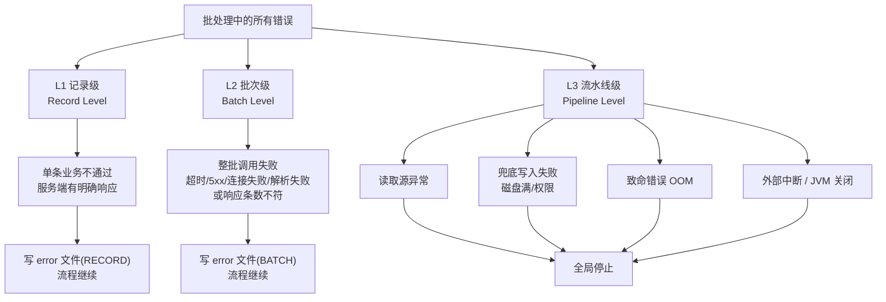

**分层原则**：L1/L2 不影响整体流程（局部失败、数据留痕）；L3 必须停止（继续跑会导致数据丢失或结果不可信）。

### 7.2 异常处理矩阵

| 场景 | 检测位置 | 处理动作 | 是否继续 |
|---|---|---|---|
| `hasNext()/next()` 抛异常 | 生产者循环 catch Throwable | 记录异常原因并 abort → 停止读取与提交 | 否 |
| `BatchFailedException` | `BatchTask.processBatch` | 整批写 error 分片（BATCH，错误码取自异常） | **是** |
| processor 抛其他 `Exception` | `BatchTask.processBatch` | 同上，错误码标记 `UNKNOWN` | **是** |
| 结果条数与批次不符 | `BatchTask` 防御校验 | 同上，错误码标记 `BAD_RESPONSE` | **是** |
| 写分片 IOException | `BatchTask.run` | `pipeline.abort()`（兜底失效，不可静默） | 否 |
| 致命 `Error`（OOM 等） | `BatchTask.run` | `pipeline.abort()` | 否 |
| 线程池拒绝任务 | `submitBatch` | release 名额 + abort | 否 |
| JVM 关闭信号 | ShutdownHook | abort，生产者 200ms 内感知退出 | 否（优雅） |
| 等待在途批次超时 | `awaitTermination` | `shutdownNow()` 强制关闭 | 收尾 |
| 合并失败 | `mergeOutputs` | 保留分片、不 rename，异常上抛 | 否 |

### 7.3 停止传播机制

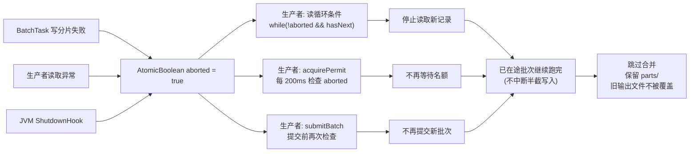

**为什么中止时不中断在途批次？** 批量写操作被拦腰截断会产生半截状态的数据，比多等待数百毫秒难收拾得多。因此停止语义定义为「**停止生产 + 自然收敛**」，而非「立即杀死一切」。

---

## 8. 接口规格（SPI 契约）

### 8.1 RecordReader<T>

```java
public interface RecordReader<T> extends Closeable {
    boolean hasNext() throws Exception;
    T next() throws Exception;
}
```

| 约定 | 说明 |
|---|---|
| 结束判定 | 由 `hasNext()` 返回 false 表达，**不使用 null 作为结束标记** |
| 调用顺序 | 仅在 `hasNext()` 为 true 后调用 `next()` |
| 异常 | 允许抛受检异常，内核捕获后触发全局停止 |
| 资源释放 | 实现 `close()`，内核在收尾阶段必定调用 |

**设计说明**：采用 `hasNext/next` 形态而非 `read()` 返回 null，是因为后者依赖隐含约定且在某些数据格式下会产生歧义；同时相比 JDK 的 `Iterator`（其 `next()` 无法声明受检异常），自定接口能让 IO 异常原样穿透，不必包装成运行时异常后在上层解包。

**适配器**：见 `RecordReaders.fromIterator()` / `fromReadFunction()`，内部通过预读缓存实现 `hasNext()`。

### 8.2 BatchProcessor<T, P>

```java
public interface BatchProcessor<T, P> {
    List<ItemResult<P>> process(List<T> batch, long batchSeq) throws BatchFailedException;
}
```

| 约定 | 说明 |
|---|---|
| 入参 | `batch` 最后一批可能不足 `batchSize`；`batchSeq` 从 1 递增 |
| 返回 | 必须与 `batch` **一一对应且顺序一致**（内核有防御校验） |
| 成功/失败判定 | **由实现方判定**，内核不解读业务状态码语义 |
| 整批失败 | 抛 `BatchFailedException`，携带 errorCode |
| 线程安全 | 实现需支持被 N 个线程并发调用（无共享可变状态或使用同步） |

### 8.3 LineFormatter<T, P>

```java
public interface LineFormatter<T, P> {
    String formatSuccess(T record, ItemResult<P> result);
    String formatRecordFailed(T record, ItemResult<P> result);
    String formatBatchFailed(T record, String errorCode, String message);
}
```

| 约定 | 说明 |
|---|---|
| 返回值 | 单行文本，**不应包含换行符**（内核统一追加 `\n`） |
| 主输出 / 错误文件 | 可注入同一个实现，也可分别注入不同实现 |
| 级别列 | 建议在 `formatRecordFailed` 输出 `RECORD`、在 `formatBatchFailed` 输出 `BATCH` |

### 8.4 ItemResult<P>

| 字段 | 含义 |
|---|---|
| `status` | SUCCESS / FAILED |
| `code` | 状态码（由使用方定义，内核仅用于分布统计） |
| `payload` | 附加内容（泛型 P，来自服务端响应） |
| `message` | 失败信息 |

---

## 9. 配置规格

### 9.1 参数表

| 参数 | 类型 | 默认值 | 必填 | 说明 |
|---|---|---|---|---|
| `reader` | `RecordReader<T>` | — | ✅ | 读取实现 |
| `processor` | `BatchProcessor<T,P>` | — | ✅ | 批处理实现 |
| `channels` | `Map<String, OutputChannel<T,P>>` | — | ✅ | 输出通道表（含必填的错误通道，见 §11.2） |
| `batchSize` | int | 100 | | 每批条数，> 0 |
| `consumerThreads` | int | 2 | | 并行消费者线程数 N，> 0 |
| `bufferBatches` | int | 1 | | 缓冲位数 B，≥ 0 |
| `partsDir` | File | — | ✅ | 分片目录 |
| `awaitTerminationSeconds` | long | 60 | | 等待在途批次上限 |
| `charset` | Charset | UTF-8 | | 读写编码 |
| `deletePartsOnSuccess` | boolean | true | | 合并成功后清理分片 |

通道的空文件策略是 per-channel 的（`OutputChannel.createEmpty`，默认 false）。

派生量：`maxInflightBatches = max(N, N + B)`（当 B 为负时自动保护）。

### 9.2 调参建议

| 场景 | 建议 |
|---|---|
| 批处理远慢于读 100 行（常见） | `bufferBatches = 1` 足够，再大只是白占内存 |
| 读取源本身慢（网络流、复杂解析） | 可提高 `bufferBatches` 至 2~3 |
| 服务端并发能力弱 | 降低 `consumerThreads`，用 `bufferBatches` 平滑 |
| 单条数据体积大 | 控制 `maxInflight × batchSize × 单条大小` 在可接受内存内 |

**内存估算公式**：`峰值记录数 = (N + B) × batchSize`。

---

## 10. 可观测性设计

### 10.1 统计指标（运行结束自动打印）

| 指标 | 来源 | 用途 |
|---|---|---|
| 读取记录数 | `readCount` | 与输入行数核对 |
| 提交批次数 / 成功批次数 / 批次级失败批次数 | `batchSubmitted/batchOk/batchFailed` | 判断失败范围 |
| 成功记录数 / 记录级失败数 / 批次牵连记录数 | `recordSuccess/recordFailed/recordBatchFailed` | 数据守恒校验 |
| **状态码分布** | `errorCodeCounts` | 一眼看出哪类错误最多 |
| 总耗时 / 平均每批耗时 | 起止时间 | 性能评估与调参依据 |

### 10.2 日志约定

| 级别 | 场景 | 示例 |
|---|---|---|
| INFO | 启动参数、每批完成、生产者结束、合并结果、汇总 | `批次 #7 完成: 成功 98 条 / 记录级失败 2 条` |
| WARN | 批次级失败、背压等待、提前中止、停机超时 | `批次 #5 整批失败: code=HTTP_500 …` |
| ERROR | 读取失败、兜底写入失败、致命错误 | `写入分片失败，触发全局停止` |

日志门面 `PipelineLog` 为零依赖实现，替换为 SLF4J 只需修改该类的方法体，无需改动任何业务代码。

---

## 11. 扩展性设计

### 11.1 新增一种文件类型的批处理任务

只需三步，内核零改动：

1. 实现 `RecordReader<YourRecord>`（或用适配器包装现有读取工具）；
2. 实现 `BatchProcessor<YourRecord, YourPayload>`（换成真实的批量 HTTP 调用）；
3. 实现 `LineFormatter<YourRecord, YourPayload>`（定义该类型的行格式）。

### 11.2 已预留的扩展点

| 扩展点 | 方式 |
|---|---|
| 输出还需第三种文件（如告警文件） | **已实现（v1.1）**：`channel("alarm", file, fmt)` 声明即可，见 §14 |
| 需要批次结果明细留存 | 在 `BatchTask` 中增加 `ResultCollector` 回调 |
| 需要进程级断点续跑 | 读取异常时 `parts/` 已保留，按最大批次序号跳过已处理批次即可实现 |
| 需要 Prometheus 指标 | 从 `PipelineStats` 取值导出 |
| 需要动态限流 | 将 `Semaphore` 替换为可调整许可数的信号量包装 |

### 11.3 明确的职责边界

| 内核负责 | 使用方负责 |
|---|---|
| 线程、并发度、名额 | 记录如何解析 |
| 批的大小与切分 | 调用什么接口、如何判定成败 |
| 失败落盘与级别标记 | 输出行长什么样 |
| 合并、原子落地、清理 | 告警/监控接入 |
| 停止传播与资源释放 | 幂等与重试策略（如需） |

---

## 12. 验证记录

### 12.1 功能验证清单

| # | 验证项 | 方法 | 结果 |
|---|---|---|---|
| 1 | 正常批处理与尾批 | 1050 行输入 → 11 批（最后一批 50 条） | PASS |
| 2 | 数据守恒（统计层） | 成功 + 记录级失败 + 批次牵连 == 读取总数 | PASS |
| 3 | 数据守恒（文件层） | 主输出行数 + 错误文件行数 == 输入行数（105 = 73 + 32） | PASS |
| 4 | 批次级失败落盘 | 注入 25% 批次失败 → 2 批失败，20 条全部进错误文件 | PASS |
| 5 | 级别区分 | 错误文件中 `RECORD` 与 `BATCH` 行并存可辨 | PASS |
| 6 | 背压生效 | 消费者耗时大于读取速度时日志出现等待提示 | PASS |
| 7 | 合并保持行序 | 合并后首列字典序单调不减 | PASS |
| 8 | 读取异常全局停止 | 第 35 条抛 IOException → 停在 34 条并抛出异常 | PASS |
| 9 | 中止时不覆盖旧产出 | 预置旧文件在异常流程后内容未被修改 | PASS |
| 10 | 中止时保留现场 | `parts/` 目录保留已完成的批次分片 | PASS |
| 11 | 适配器读取方式 | `fromReadFunction` 包装 read() 工具类，结果与专用实现一致 | PASS |

### 12.2 实测运行数据（Demo 默认配置）

```
输入 1050 行 · batchSize=100 · consumers=4 · buffer=1 · maxInflight=5

读取记录数        : 1050
提交批次数        : 11
成功批次数        : 11
批次级失败批次数  : 0
成功记录数        : 996
记录级失败数      : 54
失败记录合计      : 54
总耗时            : 492 ms
平均每批耗时      : 44 ms
状态码分布        : OK 996 / E3003 21 / E2002 17 / E1001 16
```

产物：`demo-run/output/sample.success`（996 行）、`demo-run/output/sample.error`（54 行）。

---

## 13. 附录

### 13.1 源码索引

| 文件 | 对应设计章节 |
|---|---|
| `FileBatchPipeline.java` | 5.1 主流程 / 5.2 生产者 / 4.2 背压 / 7.3 停止传播 |
| `BatchTask.java` | 5.3 消费者流程 / 7.2 异常矩阵 |
| `RecordReader.java` / `RecordReaders.java` | 8.1 读取接口与适配器 |
| `BatchProcessor.java` / `ItemResult.java` / `BatchFailedException.java` | 8.2 / 8.4 处理契约 |
| `LineFormatter.java` | 8.3 输出契约 |
| `PartWriter.java` | 6.1 数据流 / 6.2 分片命名 |
| `OutputMerger.java` | 5.4 合并流程 / 6.2 目录规范 |
| `PipelineConfig.java` | 9 配置规格 |
| `PipelineStats.java` | 10.1 统计指标 |
| `DemoLineReader/DemoHttpProcessor/DemoLineFormatter/DemoMain` | 11 扩展实践示例 |

### 13.2 术语表

| 术语 | 含义 |
|---|---|
| 批次 / Batch | 一次批处理的最小交付单元，默认 100 条 |
| 在途批次 / Inflight | 已提交给消费者但尚未处理完成的批次 |
| 名额 / Permit | 信号量许可，代表一个允许在途的批次槽位 |
| 缓冲位 / Buffer | 超出并行线程数的额外槽位，用于预读平滑抖动 |
| 记录级失败 | 服务端有响应但单条业务未通过，级别 `RECORD` |
| 批次级失败 | 整批调用未获结果，级别 `BATCH` |
| 分片 / Part | 单个批次的中间产物文件，合并后删除 |

### 13.3 常见问题

**Q：为什么不直接用 `ExecutorService` + 有界队列做限流？**
A：有界队列限制的是"排队数量"，无法精确表达"正在处理的批次数 ≤ N"。需求明确要求"消费者都在忙时不应再生产批次"，信号量是对"在途未完成"的直接建模。

**Q：为什么成功和失败要写成分片再合并，而不是直接追加到一个文件？**
A：直接追加需要锁（退化串行、顺序不可控），且在失败时会留下残缺的输出文件。分片方案零锁竞争 + 原子 rename + 天然保持行序。

**Q：能否让失败批次的自动重试？**
A：当前按需求未内置重试（错误处理以状态码记录为准）。如需重试，在 `BatchProcessor` 实现内部自行退避重试即可，不影响内核。

**Q：输出文件的行序有保证吗？**
A：有，但**在通道内部**。分片按批次序号零填充命名，合并按升序进行，因此每个通道的行序等于该通道记录在输入中的相对顺序（即使各批次并行完成顺序是乱的）。跨通道不保证全局顺序——这是"分到不同文件"的必然结果，不是缺陷。

---

## 14. 多输出通道（v1.1）

### 14.1 动机

v1.0 的分流是硬编码二选一，散落在五处：`PipelineConfig` 四个字段、`PartWriter` 两个后缀常量、
`PartWriter.writeResults` 的 `if/else`、`BatchTask` 的 `int[]{ok,ng}`、`mergeOutputs` 的两次固定调用。

真实场景是「按业务状态分文件」：批量查订单状态，已付款 / 已发货 / 已完成 / 已取消 各一个文件，
查询失败与未识别状态进错误文件。这不是"多几个文件名"，而是**通道必须成为一等公民**。

### 14.2 通道模型

```java
OutputChannel<T, P> = key + target(File) + formatter + createEmpty + isError
```

- 声明期（`build()`）确定全部通道，运行期只读；
- `key` 是唯一凭据，用于分片子目录名与日志标签，约束 `[A-Za-z0-9][A-Za-z0-9._-]{0,47}`；
- `formatter` 每通道独立——不同文件可以有不同的列结构，这是最常见的真实需求；
- `createEmpty` 每通道独立——`error` 通道常设为 true 以便告警侧统一取文件，业务通道默认不生成。

### 14.3 路由

`RoutingProcessor<T,P>` 是 `BatchProcessor` 的**可选**扩展，不实现则行为与 v1.0 完全一致。

解析顺序（`ChannelRouter.resolve`）：

1. 处理器实现了 `RoutingProcessor` → 取其返回值；
2. 返回 `null` → 按状态走默认（成功 → `success`，失败 → `error`）；
3. 返回的 key 未在配置中声明 → 落错误通道，标记 fallback，累计计数，首次出现时告警。

**为什么是白名单而不是"边跑边建"**：动态建通道看起来更灵活，但一个大小写错误或多一个空格
（`"paid "`）就会静默产出一组没人读的文件，程序不报错，下游照常读旧文件，往往到对账日才发现
数据分错了地方。白名单 + 兜底 + 计数把这类事故压缩成一条明确日志：

```
[WARN] 未注册的输出通道 "partial_shipped"（批次内下标 94，记录 ORD-000095|...），已兜底到 "error"
[WARN] 存在未注册的输出通道：共 50 条记录被兜底到 "error"，分布 {partial_shipped=50}
```

### 14.4 两个必须处理的正确性问题

**① 兜底记录的格式一致性**
兜底记录往往"业务上是成功的"（如订单状态查到了，但那个状态没有对应通道）。若按成功格式
写入错误文件，错误文件里就会混入列数不同的行，下游按列解析直接错位。

处理：`PartWriter.format()` 对 fallback 记录合成一条 `UNROUTED:{requestedKey}` 的失败结果，
强制走错误格式：

```
ORD-000095|CUST-00096|45.15	RECORD	UNROUTED:partial_shipped	通道 partial_shipped 未注册（原始结果码 PARTIAL）
```

**② 分片目录的递归清理**
多通道下 `parts/` 里是子目录，`File.delete()` 只能删空目录。若不递归，上次运行的分片会残留
并被合并进本次输出——这类 bug 极难发现（数据"变多了"，但不报错）。`prepareDirectories()` 现改为
`OutputMerger.deleteChildren()` 递归清理，并检查 `delete()` 返回值。

### 14.5 守恒关系

每条记录恰好落一个通道，因此：

```
Σ(各通道行数) = 输入条数
```

批次级失败整批计入错误通道，不破坏该等式。Demo 实测 `1000 = 397 + 298 + 149 + 99 + 57`。

**注意**：`PipelineStats` 的「失败记录合计」只统计 `FAILED` 与 BATCH 牵连记录，不含 fallback；
fallback 有独立计数（`ChannelRouter.unregisteredTotal()`）。两者不要混看。

### 14.6 v1.1 起移除的旧 API（迁移对照）

v1.0 的二通道写法在通道化改造初期以语法糖形式保留过一段时间，现已**整体移除**，
内核与配置层只有一套通道 API。旧写法 → 新写法的对照：

| v1.0 写法（已移除） | 现在的等价写法 |
|---|---|
| `successFile(f)` + `successFormatter(fmt)` | `channel("success", f, fmt)`（保留 key） |
| `errorFile(f)` + `errorFormatter(fmt)` | `errorChannel(f, fmt)` 或 `channel(OutputChannel.error(f, fmt))` |
| `createEmptyOutput(true)`（全局） | 对需要的通道单独调 `OutputChannel.of(...).createEmpty(true)` |
| 处理器只实现 `BatchProcessor` | 不变：路由退化为"成功→success，失败→error" |

`build()` 现在额外做一道角色校验：key 为 `error` 的通道必须用 `OutputChannel.error(...)`
声明（`isErrorChannel == true`），用 `channel("error", ...)` 声明成普通通道会被直接拒绝——
否则兜底与批次级失败会写进一个语义上是"普通输出"的通道，下游无法区分。

### 14.7 明确不支持的两种形态

| 形态 | 为什么不做 |
|---|---|
| **动态分区**（按机构/日期等字段拆出成千上万个文件） | 需要分区爆炸治理（文件句柄、小文件）、路径消毒（key 来自数据，含 `/`、`..` 即目录穿越）、延迟建目录、跨批次 key 集合合并规则。属于另一套设计，不是加个 `Map` 能覆盖的 |
| **一对多产出**（100 条输入 → 120 条输出） | 会破坏 `BatchTask` 的 1:1 校验（这是"一条不丢"的唯一凭据），守恒式要换成"输入覆盖率 100%"，还要给每行加源记录序号才能追溯与重试。代价远超收益 |

若确实需要，应作为独立设计评审，而不是在现有 SPI 上打补丁。

