# 通用批处理流水线模板 · 系统设计文档

| 项目 | 内容 |
|---|---|
| 文档名称 | 通用批处理流水线模板（Java）系统设计说明书 |
| 版本 | 当前设计（多通道 + 内置分组 + 可插拔输出目标） |
| 日期 | 2026-11-01 |
| 状态 | 已实现并通过验证 |
| 运行环境 | JDK 8+（代码按 Java 8 语法编写，JDK 20 实测通过） |
| 第三方依赖 | 无（纯 JDK，运行时零第三方依赖） |
| 源码规模 | 41 个 Java 文件（内核 25 / 示例 12 / 测试 4）/ 约 4090 行 |

---

## 1. 项目概述

### 1.1 背景与目标

业务侧存在一类**"有终点、有大批量数据"**的批处理任务：从一个数据源（文件）顺序读取记录，按固定批量调用远端 HTTP 接口逐批处理，最终把处理结果（原始记录 + 处理结果状态码 + 服务端返回的附加内容）落成一个或多个输出文件。

这类任务的共性痛点：

1. **串行处理太慢**，需要多消费者并发；
2. **不能无限预读**，否则内存随文件大小线性膨胀、失败时难以收拾；
3. **失败必须可区分**：服务端明确的业务失败 vs 整批调用失败，处理方式完全不同；
4. **每种文件格式/接口的输出格式都不一样**，重复造轮子成本高。

因此本项目的目标是：**把批处理中"不变的部分"（并发、背压、落盘、合并、容错、统计）沉淀成通用内核，把"变化的部分"（读取、调用、格式化）抽象成 SPI 接口**，使不同文件类型的批处理任务只需提供三个业务实现即可复用同一套运行时。

### 1.2 核心特性

| 特性 | 说明 |
|---|---|
| 批次级传输 | 传输单元是"批次"（默认 100 条），而非单条记录 |
| 严格背压 | 信号量控制在途批次数，消费者忙且缓冲占满时生产者停止读取 |
| 可配并发 | `consumerThreads`(N) + `bufferBatches`(B)，在途上限 = N + B |
| 失败可区分 | 记录级失败与批次级失败均落错误通道，由错误码（如 `BATCH_*` 前缀）区分，无独立级别列 |
| 数据不丢 | 任何路径下「输入行数 = 输出成功行数 + 错误行数」 |
| 原子落地 | 写入暂存流 → `commit()` 才对外可见（文件目标 = `.tmp` + 原子 rename），下游不会读到半截文件 |
| 优雅停止 | 异常/中断时停在安全边界：在途批次跑完、不覆盖旧产出、保留分片现场 |
| 零依赖 | 纯 JDK 并发工具；Maven 构建，运行时零第三方依赖 |

### 1.3 非目标（Out of Scope）

- **不实现具体的 HTTP 调用**：由使用方在 `BatchProcessor` 中实现；
- **不实现具体的数据解析/输出格式**：由使用方的 `RecordReader` / `RecordFormatter` 决定；
- **不内置进程级断点续跑**：停止时保留 `parts/` 分片以支持外部实现，当前版本未内置自动续跑；
- **不做分布式**：单机多线程模型，不涉及跨节点协调。

---

## 2. 需求规格

### 2.1 功能性需求

| 编号 | 需求 | 实现位置 | 状态 |
|---|---|---|---|
| FR-1 | 采用生产者消费者模式 | `BatchPipeline` + `BatchTask` | 已实现 |
| FR-2 | 生产者负责读取文件并累计成批 | 生产者线程 + `BatchingStrategy`（按数量 / 按 key 分组） | 已实现 |
| FR-3 | 每累计 100 条做一次批处理 | `batchSize` 参数 + 尾批提交 | 已实现 |
| FR-4 | 生产者单线程；消费者支持多线程，线程数可配 | `Thread(batch-producer)` + `ThreadPoolExecutor(N)` | 已实现 |
| FR-5 | 无闲置空间时生产者停止生产（背压） | `Semaphore(N+B)`，`acquirePermit()` | 已实现 |
| FR-6 | 缓冲位数可配置 | `bufferBatches` 参数 | 已实现 |
| FR-7 | 读取源可替换（通用接口） | `RecordReader` SPI + `RecordReaders` 适配器/组合器 | 已实现 |
| FR-8 | 调用 HTTP 接口做批处理 | `BatchProcessor` SPI | 已实现（Demo 为模拟） |
| FR-9 | 记录每条记录的处理结果状态码 | `ItemResult`（success 布尔位 + code/payload/message） | 已实现 |
| FR-10 | 批次失败/记录失败均落盘，由错误码区分 | 失败行统一由通道的 `RecordFormatter` 渲染（Demo 为 `错误码 \t 错误信息 \t 原始记录`） | 已实现 |
| FR-11 | 成功与失败分流到独立输出文件（可扩展到多通道） | `PartWriter` 按通道路由分片 + `OutputMerger` 逐通道交付 | 已实现 |
| FR-12 | 每个通道的批次结果最终合并成该通道的一个输出 | `OutputMerger`（按序号升序流式合并 → `ChannelTarget.commit()`） | 已实现 |
| FR-13 | 输出格式按文件类型可替换 | `RecordFormatter` SPI（成功/错误通道共用） | 已实现 |
| FR-14 | 失败后继续处理后续批次（不 fail-fast） | `BatchTask.handleBatchFailed()` | 已实现 |
| FR-15 | 读取异常时终止整个流程 | `abort()` + 生产者 catch Throwable | 已实现 |
| FR-16 | 结束时输出统计汇总 | `PipelineStats.printSummary()` | 已实现 |

### 2.2 非功能性需求

| 编号 | 需求 | 设计对策 | 验证 |
|---|---|---|---|
| NFR-1 | 内存占用与文件大小无关 | 在途上限 M 固定，最坏驻留 (N+B)×batchSize 条 | 上界可证 |
| NFR-2 | 数据零丢失 | 三条守恒校验 + 失败必落盘 + 兜底失效即停止 | 已验证 |
| NFR-3 | 输出文件原子可见 | `ChannelTarget`：写入暂存流 → `commit()` 才对外可见（文件实现 = `write .tmp → ATOMIC_MOVE`） | 已实现 |
| NFR-4 | 失败可诊断 | 分片保留、错误码分布统计、批次序号溯源 | 已验证 |
| NFR-5 | 可观测 | 统计指标 + 分级日志（含背压提示） | 已实现 |
| NFR-6 | 可移植 | 仅用 JDK 8 API，无第三方依赖 | JDK20 实测 |
| NFR-7 | 可扩展 | 读取 / 处理 / 格式化 / 路由 / 输出目标全部是 SPI，内核零业务耦合 | Demo 多形态 + 27 个单测 |
| NFR-8 | 优雅停机 | 支持 JVM 关闭钩子与在途批次等待上限 | 已实现 |

### 2.3 约束与假设

- **假设 1**：数据源是顺序读取的，且由单个线程读取即可满足吞吐（读取速度远快于批处理调用）；
- **假设 2**：批处理接口具备幂等性或允许重跑（本模板不负责去重）；
- **约束 1**：`BatchProcessor` 返回的结果列表必须与输入批次**一一对应、顺序一致**（内核有防御校验）；
- **约束 2**：磁盘需预留约 **2 倍输出文件大小**的空间（分片期 + 合并期峰值）。

---

## 3. 系统架构设计

### 3.1 分层架构

```
┌──────────────────────────────────────────────────────────────┐
│  接入层 / 业务实现层（使用方提供，随文件类型变化）              │
│  RecordReader     BatchProcessor     RecordFormatter（成功/错误通道共用） │
│  (读取实现)        (HTTP调用实现)       (输出格式实现)                   │
└───────────────┬──────────────┬─────────────────┬─────────────┘
                │              │                 │
┌───────────────▼──────────────▼─────────────────▼─────────────┐
│  编排层（Orchestration）                                       │
│  BatchPipeline：生命周期、参数装配、停止传播、合并调度        │
└───────────────┬──────────────────────────────────────────────┘
                │
┌───────────────▼──────────────────────────────────────────────┐
│  执行层（Execution）                                           │
│  生产者线程   Semaphore背压   消费者线程池   BatchTask         │
└───────────────┬──────────────────────────────────────────────┘
                │
┌───────────────▼──────────────────────────────────────────────┐
│  存储层（Persistence）                                         │
│  PartWriter（分片写入/分流）  OutputMerger（合并）             │
│  ChannelTarget（交付：open 暂存 / commit 可见）                │
└───────────────┬──────────────────────────────────────────────┘
                │
┌───────────────▼──────────────────────────────────────────────┐
│  支撑层（Cross-cutting）                                       │
│  PipelineConfig · PipelineStats · PipelineLog · 异常模型       │
└──────────────────────────────────────────────────────────────┘
```

分层原则：**依赖方向单向向下**，上层可以调用下层，下层不感知上层；接入层通过接口注入，与内核层零编译期耦合。

### 3.2 模块划分

| 模块 | 包名 | 职责 | 是否需改动 |
|---|---|---|---|
| 内核 core | `com.example.batch` | 并发、背压、落盘、合并、交付、统计、停机 | 通用不变（分组为 opt-in，仅成批层可替换，见 §15.2–15.3） |
| 业务实现 demo | `com.example.demo` | 读取/调用/格式化的具体实现 | 替换为生产实现 |
| 测试 | `src/test/java/com/example/batch` | 成批策略、读取组合器与端到端行为 | 随内核改动同步更新 |

### 3.3 系统架构图

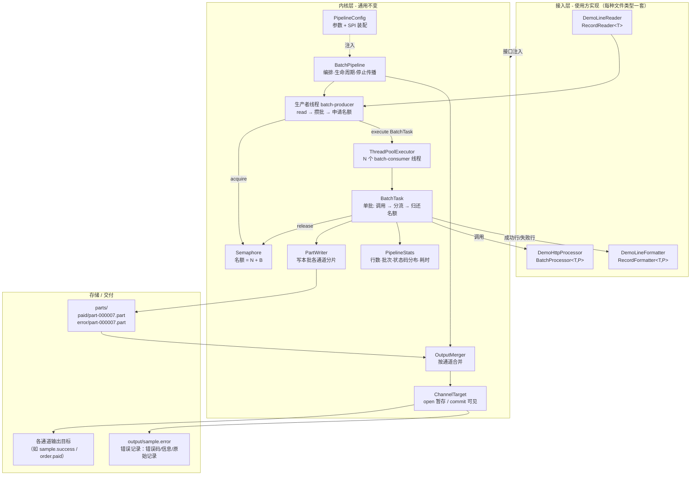

### 3.4 核心类图

```mermaid
classDiagram
    class RecordReader~T~ {
        <<interface>>
        +hasNext() boolean
        +next() T
        +close()
    }
    class RecordReaders {
        <<utility>>
        +fromIterator(Iterator~T~) RecordReader~T~
        +fromIterable(Iterable~T~) RecordReader~T~
        +fromReadFunction(ExSupplier~T~) RecordReader~T~
        +skipping(src, n) RecordReader~T~
        +filtering(src, keep) RecordReader~T~
        +headerAware(src, isHeader) RecordReader~T~
        +footerAware(src, isFooter) RecordReader~T~
        +mapping(src, fn) RecordReader~O~
    }
    class ChannelTarget {
        <<interface>>
        +open() OutputStream
        +commit()
    }
    class ChannelTargets {
        <<utility>>
        +file(File) ChannelTarget
    }
    class BatchProcessor~T_P~ {
        <<interface>>
        +process(List~T~ batch, long batchSeq) List~ItemResult~P~~
    }
    class RecordFormatter~T_P~ {
        <<interface>>
        +format(T, ItemResult~P~) String
    }
    %% 错误通道与普通通道共用 RecordFormatter，无独立接口
    class ItemResult~P~ {
        -boolean success
        -String code
        -P payload
        -String message
        +success(code, payload)$ ItemResult~P~
        +failed(code, message)$ ItemResult~P~
        +isSuccess() boolean
    }
    class BatchFailedException {
        -String errorCode
        +getErrorCode() String
    }
    class BatchPipeline~T_P~ {
        -PipelineConfig config
        -PipelineStats stats
        -AtomicReference abortState
        -Semaphore semaphore
        -ExecutorService pool
        +run() BatchResult
        +abort(Throwable)
        -produce()
        -submitBatch(long, List~T~)
        -acquirePermit()
        -awaitPoolTermination()
        -mergeOutputs()
    }
    class BatchTask~T_P~ {
        -long batchSeq
        -List~T~ batch
        -Semaphore semaphore
        +run()
        -processBatch()
        -handleBatchFailed(String, String)
    }
    class PartWriter~T_P~ {
        +writeResults(long, List~T~, List~ItemResult~P~~) Map~String,Integer~
        +writeBatchFailed(long, List~T~, String, String) int
    }
    class BatchingStrategy~T~ {
        <<interface>>
        +add(T)
        +drainReadyBatches() List~List~T~~
        +drainAll() List~List~T~~
    }
    class CountBatchingStrategy~T~ {
        -List~T~ pending
    }
    class GroupBatchingStrategy~T_K~ {
        -Map~K,List~T~~ buckets
    }
    class OutputMerger {
        <<utility>>
        +merge(channelPartsDir, target, charset, createEmpty) long
        +cleanup(partsDir)
    }
    class PipelineConfig~T_P~ {
        -int batchSize
        -int consumerThreads
        -int bufferBatches
        +maxInflightBatches() int
    }
    class PipelineStats {
        -AtomicLong readCount
        -AtomicLong recordSuccess
        -AtomicLong recordFailed
        -AtomicLong recordBatchFailed
        +printSummary()
    }

    BatchPipeline --> PipelineConfig : 持有
    BatchPipeline --> PipelineStats : 持有
    BatchPipeline --> BatchingStrategy : 生产者使用（按数量 / 按分组键）
    BatchPipeline --> ChannelRouter : 分流
    BatchingStrategy <|.. CountBatchingStrategy
    BatchingStrategy <|.. GroupBatchingStrategy
    GroupBatchingStrategy ..> GroupKeyExtractor : 取分组键
    BatchPipeline --> BatchTask : 提交
    BatchPipeline --> OutputMerger : 合并
    BatchPipeline ..> RecordReader : 依赖(注入)
    PipelineConfig --> OutputChannel : 通道表
    OutputChannel --> ChannelTarget : 输出目标
    ChannelTargets ..> ChannelTarget : 创建
    OutputMerger ..> ChannelTarget : 写入并提交
    BatchTask --> BatchProcessor : 调用(注入)
    BatchTask --> PartWriter : 写分片
    BatchTask ..> RecordFormatter : 通过PartWriter使用（成功/错误通道共用）
    BatchTask ..> BatchFailedException : 捕获/抛出
    BatchProcessor ..> ItemResult : 返回
    RecordReaders ..> RecordReader : 适配产出
```

---

## 4. 并发模型设计

### 4.1 线程模型

| 角色 | 线程 | 数量 | 职责 |
|---|---|---|---|
| 生产者 | `batch-producer` | 1 | 顺序读取、攒批、申请名额、提交任务 |
| 消费者 | `batch-consumer-1..N` | N = `consumerThreads` | 执行单批处理：调用 + 分流写入 + 归还名额 |
| 编排者 | 调用线程（main） | 1 | 启动生产者、等待线程池终止、合并、收尾、统计 |
| 守护 | `batch-shutdown-hook` | 0~1 | JVM 关闭时请求优雅停止 |

设计取舍：**生产者不占用线程池名额**，独立单线程运行；调用线程负责收尾，避免额外线程间的状态同步成本。

### 4.2 背压机制（核心）

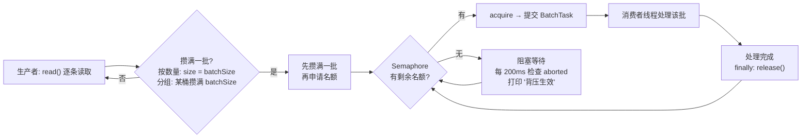

**关键设计点：**

1. **顺序是"先攒满、再申请"**（而非先占名额再读）。若顺序相反，会出现"名额被占但批次还没攒出来"的情况，白白浪费并发度，且在消费者慢时多占名额。
2. **在途上限 M = N + B**，其中 B 是缓冲位数：
   - `B = 0`：严格模式，消费者一空闲必须等生产者现读一批；
   - `B = 1`（推荐）：允许生产者提前攒一批备着，消除等待抖动；
   - `B ≥ 2`：更强的预读，背压反馈变迟钝，仅当读取源本身很慢时才有价值。
3. **等待可中断**：`tryAcquire(200ms)` 循环 + 每轮检查 `aborted`，保证停机指令能在 200ms 内被感知，不会永久阻塞。
4. **名额必定归还**：`BatchTask.run()` 的 `finally` 中 `release()`，无论成功、失败、异常都不会泄漏。这也是本设计不采用"有界队列"的一大原因——队列的弹出与任务完成之间存在窗口，难以精确表达"正在处理的批次数"。

**为什么不用有界队列做背压？**

有界队列限制的是"排队中的批次条数/个数"，它与"正在被处理的批次数"是两个概念：当两个消费者都在忙时，队列未满就意味着生产者仍可继续提交，这与需求「消费者都在工作时不应再生产批次」不符。信号量直接对"在途未完成批次数"建模，语义精确。

**分组模式下的背压（见 §15）**：内置分组只改 `produce()` 的"攒批"段（按 key 入桶、满 `batchSize` flush 单组批次），背压机制本身完全不变——在途上限 `M = N + B` 仍成立，信号量名额仍在 `BatchTask.run()` 的 `finally` 中归还。`batchSize` 在分组模式下语义变为"每桶 flush 阈值"，但名额模型不受影响；内存上界变为 `组数 × (batchSize-1) + (N+B) × batchSize`（与输入总量 N 无关）。

### 4.3 内存模型

```
最坏驻留记录数 = maxInflight × batchSize = (N + B) × batchSize
               = (4 + 1) × 100 = 500 条       （Demo 默认配置）
               = (2 + 1) × 100 = 300 条       （文档推荐配置）
```

**该上界与文件大小、消费速度无关**，是一个可由参数证明的常量级占用。

---

## 5. 核心流程设计

### 5.1 主流程（run）

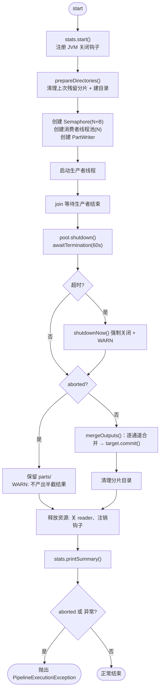

### 5.2 生产者流程

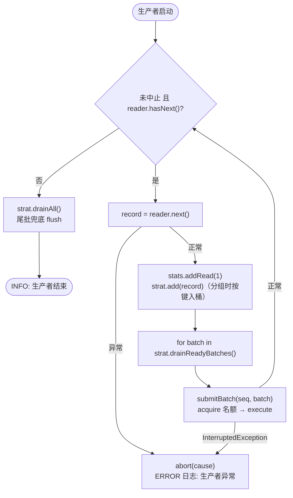

> **尾批处理**：当总记录数不是 `batchSize` 的整数倍时，剩余的不足一批的记录由 `drainAll()` 兜底提交；分组模式下各桶未满的部分同样在此刻全部提交。Demo 采用 1050 行输入正是为验证这条路径（11 批，末批 50 条）。

### 5.3 消费者流程（单批 BatchTask）

```mermaid
flowchart TB
    A([消费者取得 BatchTask]) --> B["processor.process(batch, seq)"]
    B -->|"BatchFailedException"| C["handleBatchFailed(errorCode, msg)"]
    B -->|"其他 Exception"| C2["handleBatchFailed('UNKNOWN', msg)"]
    B -->|"正常返回"| D{"results 非空<br/>且 size == batch.size()?"}
    D -- 否 --> C3["handleBatchFailed('BAD_RESPONSE', 条数不符)"]
    D -- 是 --> E["PartWriter 分流写入:<br/>成功 → success 分片<br/>FAILED → error 分片"]
    C --> F["整批写入 error 分片（批次级）<br/>batchFailed++ · 错误码计数"]
    C2 --> F
    C3 --> F
    E --> G["batchOk++<br/>逐条统计: 成功/失败/状态码分布"]
    F --> Z
    G --> Z
    Z([finally: semaphore.release()])
    Z --> Y([任务结束])
    B -->|"IOException 写分片失败"| X["pipeline.abort()<br/>兜底失效 → 全局停止"]
    B -->|"Error (OOM等)"| X
    X --> Z
```

### 5.4 合并流程

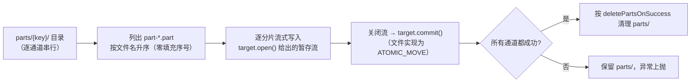

> 由于文件名前缀为 `part-%06d`（零填充），字典序即批次序号，因此**合并结果天然保持输入文件的行序**；这是分片方案的附带收益，无需额外排序。
>
> 每个通道独立走一遍 `open → 写入 → close → commit`，某个通道失败不会破坏其他通道已提交的结果；交付目标的差异（本地文件 / 对象存储）全在 `ChannelTarget` 实现里（见 §14.8）。

### 5.5 关键时序图：读取异常导致的全局停止

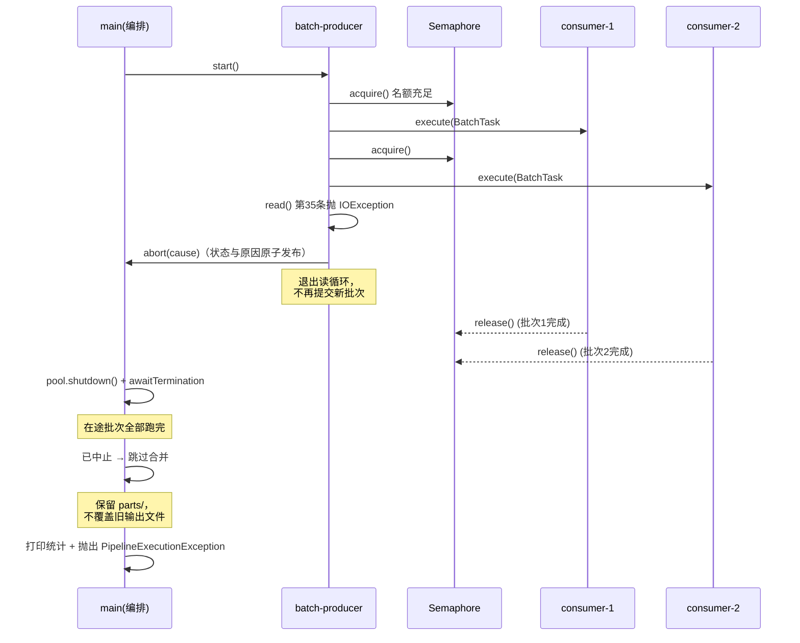

### 5.6 运行状态机

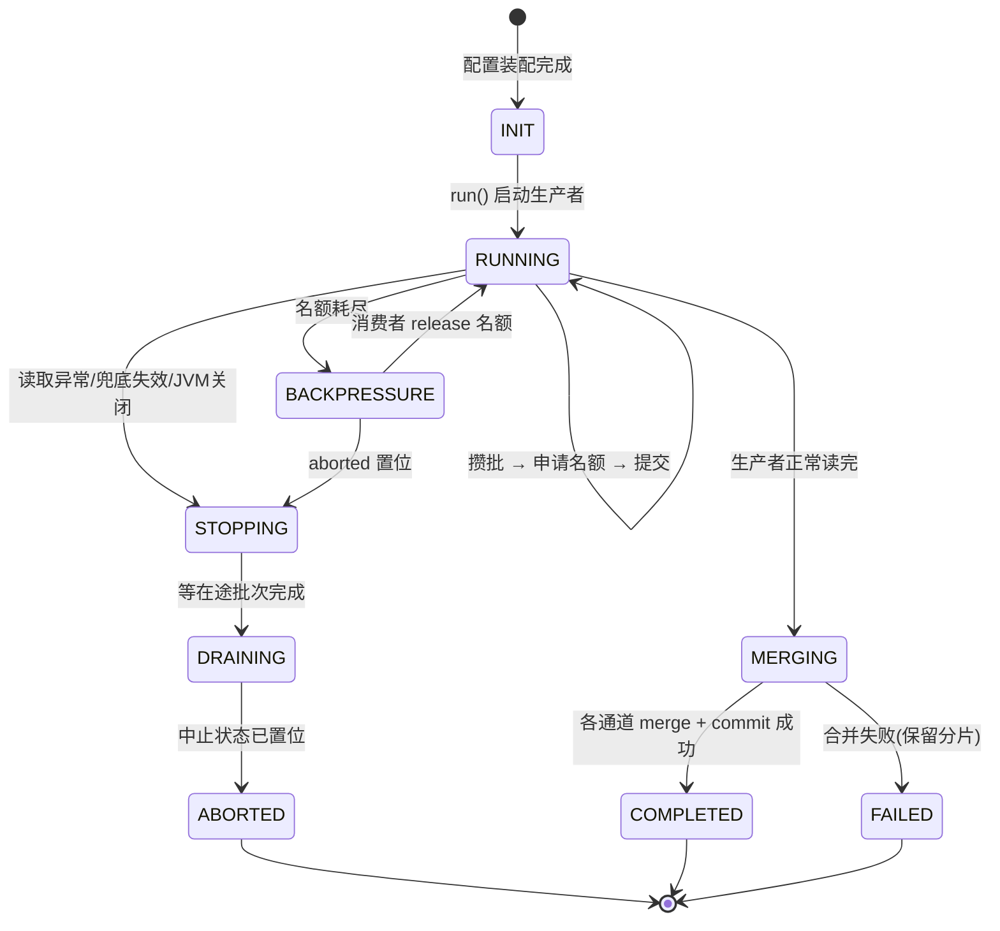

---

## 6. 数据流与存储设计

### 6.1 数据流图

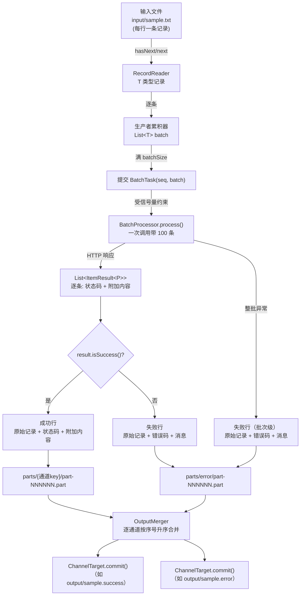

### 6.2 目录与文件命名规范

```
{工作目录}/
├── input/
│   └── sample.txt                     输入文件（使用方提供）
├── parts/                              分片目录（运行中，按通道分子目录）
│   ├── paid/
│   │   ├── part-000001.part            批次1 中落在 paid 通道的记录
│   │   └── part-000011.part
│   ├── shipped/
│   │   └── part-000001.part
│   └── error/
│       └── part-000002.part            失败记录 + 未注册路由兜底
└── output/
    ├── order.paid                      通道 paid 的最终文件
    ├── order.shipped                   通道 shipped 的最终文件
    └── order.error                     错误通道的最终文件
```

命名约定：

| 文件 | 规则 | 目的 |
|---|---|---|
| 通道分片 | `{通道key}/part-%06d.part` | 零填充保证字典序 = 批次序号；按 key 分子目录，合并时扫一个目录即可 |
| 临时输出 | `{目标}.tmp` | 由 `ChannelTarget` 实现自行决定：文件目标写同目录 `.tmp` 再 rename，保证原子可见 |
| 不存在的分片 | 不创建（只有真正有记录时才 openWriter） | "本批该通道无数据" 由此自然可判，无需额外计数 |

**为什么按通道分子目录，而不是 `part-000001.paid.part`**：

1. 合并时按目录扫描，不必解析文件名的通道部分；
2. 通道 key 不必参与文件名转义（`.` `-` 等字符不会与后缀规则冲突）；
3. 排查现场时能直接 `ls parts/paid` 定位。

**通道 key 的字符约束**：`[A-Za-z0-9][A-Za-z0-9._-]{0,47}`。必须 ASCII——中文目录名在
macOS/Linux 正常，但跨 Windows 打包、zip 解压、CI 缓存时经常乱码。业务文案放 formatter。

**分片清理策略**：

- 合并成功 → 删除整个 `parts/` 目录（含各通道子目录，受 `deletePartsOnSuccess` 控制）；
- 流水线中止 → **保留** `parts/`，作为现场用于排查或后续续跑。

> 注意：`prepareDirectories()` 必须**递归**清理 `parts/`。多通道下里面是各通道子目录，
> 若只删空目录（不递归）会残留上次运行的分片并被合并进本次输出。

### 6.3 输出格式规格

模板不固化任何格式，格式由统一的 `RecordFormatter` 决定：成功通道读 `result.getPayload()`、错误通道读 `result.getCode()`/`getMessage()`。Demo 提供的默认实现为**制表符平铺**：

**主输出文件（sample.success）**

```
{原始记录}\t{状态码}\t{附加内容}
```

示例：

```
ORD-000001|CUST-00001|10.90	OK	SID-1-1|ACCEPTED|1793420229046
```

其中附加内容为服务端逐条返回的字段（流水号 | 受理状态 | 时间戳），字段分隔方式由 `BatchProcessor` 返回的 payload 决定。

**错误文件（sample.error）**

错误通道使用与成功通道**同一个** `RecordFormatter`，只是路由保证它只会收到失败结果。
Demo 默认实现为**制表符平铺**（顺序：`错误码 → 错误信息 → 原始记录`）：

```
{错误码}\t{错误信息}\t{原始记录}
```

> 失败类别（记录级 / 批次级）不单列“级别”列，而是体现在**错误码**上（例如批次失败用 `HTTP_500`/`TIMEOUT`，记录失败用 `E1001` 等业务码）。
> 具体格式完全由你提供的 formatter 决定。

示例（Demo 默认）：

```
E1001\t余额不足\tORD-000100|CUST-00100|9.90
HTTP_500\t批量接口调用失败(HTTP_500)，耗时 127ms\tORD-000041|CUST-00041|9.90
```


---

## 7. 异常与容错设计

### 7.1 错误分层模型

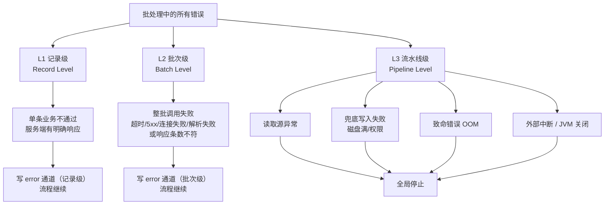

**分层原则**：L1/L2 不影响整体流程（局部失败、数据留痕）；L3 必须停止（继续跑会导致数据丢失或结果不可信）。

### 7.2 异常处理矩阵

| 场景 | 检测位置 | 处理动作 | 是否继续 |
|---|---|---|---|
| `hasNext()/next()` 抛异常 | 生产者循环 catch Throwable | 记录异常原因并 abort → 停止读取与提交 | 否 |
| `BatchFailedException` | `BatchTask.processBatch` | 整批写 error 分片（批次级，错误码取自异常） | **是** |
| processor 抛其他 `Exception` | `BatchTask.processBatch` | 同上，错误码标记 `UNKNOWN` | **是** |
| 结果条数与批次不符 | `BatchTask` 防御校验 | 同上，错误码标记 `BAD_RESPONSE` | **是** |
| 写分片 IOException | `BatchTask.run` | `pipeline.abort()`（兜底失效，不可静默） | 否 |
| 致命 `Error`（OOM 等） | `BatchTask.run` | `pipeline.abort()` | 否 |
| 线程池拒绝任务 | `submitBatch` | release 名额 + abort | 否 |
| JVM 关闭信号 | ShutdownHook | abort，生产者 200ms 内感知退出 | 否（优雅） |
| 等待在途批次超时 | `awaitTermination` | `shutdownNow()` 强制关闭 | 收尾 |
| 合并失败 | `mergeOutputs` | 保留分片、不 `commit`，异常上抛 | 否 |

### 7.3 停止传播机制

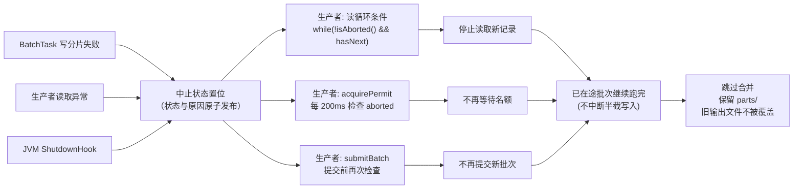

**为什么中止时不中断在途批次？** 批量写操作被拦腰截断会产生半截状态的数据，比多等待数百毫秒难收拾得多。因此停止语义定义为「**停止生产 + 自然收敛**」，而非「立即杀死一切」。

---

## 8. 接口规格（SPI 契约）

### 8.1 RecordReader<T>

```java
public interface RecordReader<T> extends Closeable {
    boolean hasNext() throws IOException;
    T next() throws IOException;
}
```

| 约定 | 说明 |
|---|---|
| 结束判定 | 由 `hasNext()` 返回 false 表达，**不使用 null 作为结束标记** |
| 调用顺序 | 仅在 `hasNext()` 为 true 后调用 `next()` |
| 异常 | 允许抛 `IOException`，内核捕获后触发全局停止 |
| 资源释放 | 实现 `close()`，内核在收尾阶段必定调用 |

**设计说明**：采用 `hasNext/next` 形态而非 `read()` 返回 null，是因为后者依赖隐含约定且在某些数据格式下会产生歧义；同时相比 JDK 的 `Iterator`（其 `next()` 无法声明受检异常），自定接口能让 IO 异常原样穿透，不必包装成运行时异常后在上层解包。

**适配器与组合器**：`RecordReaders.fromIterator()` / `fromIterable()` / `fromReadFunction()` 把现有读取工具接进来（内部用预读缓存实现 `hasNext()`）；`skipping / filtering / headerAware / footerAware / mapping` 用于丢弃表头、过滤空行、丢掉表尾、转换形态，全部是装饰器，`close()` 委派给源 reader。

### 8.2 BatchProcessor<T, P>

```java
public interface BatchProcessor<T, P> {
    List<ItemResult<P>> process(List<T> batch, long batchSeq) throws BatchFailedException;
}
```

| 约定 | 说明 |
|---|---|
| 入参 | `batch` 最后一批可能不足 `batchSize`；`batchSeq` 从 1 递增 |
| 返回 | 必须与 `batch` **一一对应且顺序一致**（内核有防御校验） |
| 成功/失败判定 | **由实现方判定**，内核不解读业务状态码语义 |
| 整批失败 | 抛 `BatchFailedException`，携带 errorCode |
| 线程安全 | 实现需支持被 N 个线程并发调用（无共享可变状态或使用同步） |

### 8.3 RecordFormatter<T, P>

所有通道（成功 / 错误 / 任意业务通道）共用同一个行格式接口，由路由保证一个 formatter 实例只会收到一种结果：

```java
/** 成功/失败记录 → 输出文件的一行；成功读 getPayload()，失败读 getCode()/getMessage() */
public interface RecordFormatter<T, P> {
    String format(T record, ItemResult<P> result);
}
```

| 约定 | 说明 |
|---|---|
| 返回值 | 单行文本，**不应包含换行符**（内核统一追加 `\n`） |
| 成功通道 | 只收到成功结果，`result.isSuccess()` 为 true，读 `result.getPayload()` |
| 错误通道（key="error"） | 只收到失败结果，读 `result.getCode()` / `result.getMessage()`；批次失败与记录失败的区别体现在错误码（如 `BATCH_*` 前缀） |
| 为什么只有一个接口 | 成功与失败的渲染本质都是「记录 + 结果 → 一行」，合并成单方法接口概念更少、API 更统一，且天然支持 lambda |

### 8.4 ItemResult<P>

| 字段 | 含义 |
|---|---|
| `success` | 布尔位：true = 成功，false = 失败（不设枚举，只有两种状态） |
| `code` | 状态码（由使用方定义，内核仅用于分布统计） |
| `payload` | 附加内容（泛型 P，来自服务端响应） |
| `message` | 失败信息 |

---

## 9. 配置规格

### 9.1 参数表

| 参数 | 类型 | 默认值 | 必填 | 说明 |
|---|---|---|---|---|
| `reader` | `RecordReader<T>` | — | ✅ | 读取实现 |
| `processor` | `BatchProcessor<T,P>` | — | ✅ | 批处理实现 |
| `channels` | `Map<String, OutputChannel<T,P>>` | — | ✅ | 输出通道表：由 `channel(...)` / `errorChannel(...)` 声明，错误通道必填（见 §14） |
| `batchSize` | int | 100 | | 每批条数，> 0 |
| `consumerThreads` | int | 2 | | 并行消费者线程数 N，> 0 |
| `bufferBatches` | int | 1 | | 缓冲位数 B，≥ 0 |
| `partsDir` | File | 系统临时目录 | | 分片目录（并行阶段的本地暂存区，与输出目标解耦） |
| `awaitTerminationSeconds` | long | 60 | | 等待在途批次上限 |
| `charset` | Charset | UTF-8 | | 读写编码 |
| `deletePartsOnSuccess` | boolean | true | | 合并成功后清理分片 |
| `groupExtractor` | `GroupKeyExtractor<T,K>` | null | | 批量前按字段分组（opt-in）；null = 按 `batchSize` 数量攒批，见 §15 |

通道的空文件策略是 per-channel 的（`OutputChannel.createEmpty`，默认 false）。

派生量：`maxInflightBatches = consumerThreads + bufferBatches`（`build()` 已校验 B ≥ 0，因此无需再取 max）。

### 9.2 调参建议

| 场景 | 建议 |
|---|---|
| 批处理远慢于读 100 行（常见） | `bufferBatches = 1` 足够，再大只是白占内存 |
| 读取源本身慢（网络流、复杂解析） | 可提高 `bufferBatches` 至 2~3 |
| 服务端并发能力弱 | 降低 `consumerThreads`，用 `bufferBatches` 平滑 |
| 单条数据体积大 | 控制 `maxInflight × batchSize × 单条大小` 在可接受内存内 |

**内存估算公式**：`峰值记录数 = (N + B) × batchSize`。

---

## 10. 可观测性设计

### 10.1 统计指标（运行结束自动打印）

| 指标 | 来源 | 用途 |
|---|---|---|
| 读取记录数 | `readCount` | 与输入行数核对 |
| 提交批次数 / 成功批次数 / 批次级失败批次数 | `batchSubmitted/batchOk/batchFailed` | 判断失败范围 |
| 成功记录数 / 记录级失败数 / 批次牵连记录数 | `recordSuccess/recordFailed/recordBatchFailed` | 数据守恒校验 |
| **状态码分布** | `errorCodeCounts` | 一眼看出哪类错误最多 |
| 总耗时 / 平均每批耗时 | 起止时间 | 性能评估与调参依据 |

状态码分布统一按**记录**计数：记录级结果按条累加，批次级失败按其牵连的记录数累加，因此各码次数之和等于读取记录数（守恒可直接核对）。

### 10.2 日志约定

| 级别 | 场景 | 示例 |
|---|---|---|
| INFO | 启动参数、每批完成、生产者结束、合并结果、汇总 | `批次 #7 完成: success 97 条 / error 3 条` |
| WARN | 批次级失败、背压等待、提前中止、停机超时 | `批次 #5 整批失败: code=HTTP_500 …` |
| ERROR | 读取失败、兜底写入失败、致命错误 | `写入分片失败，触发全局停止` |

日志门面 `PipelineLog` 为零依赖实现，替换为 SLF4J 只需修改该类的方法体，无需改动任何业务代码。

---

## 11. 扩展性设计

### 11.1 新增一种文件类型的批处理任务

只需三步，内核零改动：

1. 实现 `RecordReader<YourRecord>`（或用适配器包装现有读取工具）；
2. 实现 `BatchProcessor<YourRecord, YourPayload>`（换成真实的批量 HTTP 调用）；
3. 提供一个 `RecordFormatter<YourRecord, YourPayload>`（lambda 即可）：成功通道读 `getPayload()`，错误通道读 `getCode()`/`getMessage()`，同一个接口覆盖两种结果。

### 11.2 可扩展点

> 下表是"有需求时往哪里加"的指引。除第一行外都**需要改动内核**，不是当前已存在的钩子——
> 不要凭这张表臆造 API。

| 扩展点 | 方式 | 是否需改内核 |
|---|---|---|
| 输出还需第三种文件（如告警文件） | 用 `channel("alarm", target, fmt)` 声明即可，见 §14 | 否（已支持） |
| 输出要落到 S3 / OSS / HTTP，不止本地文件 | 实现 `ChannelTarget` 并传入，内核无需改动，见 §14.8 | 否（已支持） |
| 需要批次结果明细留存 | 在 `BatchTask` 中增加回调，把 `process()` 的返回值顺带交给使用方 | 是 |
| 需要进程级断点续跑 | 读取异常时 `parts/` 已保留，按最大批次序号跳过已处理批次即可实现 | 是 |
| 需要 Prometheus 指标 | 从 `PipelineStats` 取值导出 | 否（读取即可） |
| 需要动态限流 | 将 `Semaphore` 替换为可调整许可数的信号量包装 | 是 |

### 11.3 明确的职责边界

| 内核负责 | 使用方负责 |
|---|---|
| 线程、并发度、名额 | 记录如何解析 |
| 批的大小与切分 | 调用什么接口、如何判定成败 |
| 失败落盘（错误通道） | 输出行长什么样 |
| 合并、原子落地、清理 | 告警/监控接入 |
| 停止传播与资源释放 | 幂等与重试策略（如需） |

---

## 12. 验证记录

### 12.1 功能验证清单

| # | 验证项 | 方法 | 结果 |
|---|---|---|---|
| 1 | 正常批处理与尾批 | Demo：1050 行 → 11 批（最后一批 50 条） | PASS |
| 2 | 数据守恒（统计层） | 成功 + 记录级失败 + 批次牵连 == 读取总数（995 + 55 + 0 = 1050） | PASS |
| 3 | 数据守恒（文件层） | 主输出 995 行 + 错误文件 55 行 == 输入 1050 行 | PASS |
| 4 | 批次级失败落盘 | 单测 `batchFailureWholeBatchToError`：50 条整批进错误通道，成功 0 条 | PASS |
| 5 | 记录级失败分流 | 单测 `errorChannelConservationOnRecordFailure`：Σ各通道行数 == 输入条数 | PASS |
| 6 | 背压生效 | 消费者耗时大于读取速度时日志出现等待提示 | PASS（人工） |
| 7 | 合并保持行序 | 单测 `customChannelTargetReceivesWholeMergedOutput`：10+10+5 分片合并后与输入序一致 | PASS |
| 8 | 读取异常全局停止 | 第 35 条抛 IOException → 停在 34 条并抛出异常 | PASS（人工） |
| 9 | 中止时不覆盖旧产出 | 预置旧文件在异常流程后内容未被修改 | PASS（人工） |
| 10 | 中止时保留现场 | `parts/` 目录保留已完成的批次分片 | PASS（人工） |
| 11 | 适配器与读取组合器 | 单测 `RecordReadersTest`（11 例）：适配器一致性 + 跳过/过滤/表头/表尾/映射 | PASS |
| 12 | 内置分组单组保证 | Demo：120 条 → 12 个单组批次；单测 `groupingSingleGroupGuaranteeAndConservation` | PASS |
| 13 | 多通道分流与兜底 | Demo：1000 = 397 + 298 + 149 + 99 + 57；未注册状态 50 条兜底并告警 | PASS |
| 14 | 输出目标可替换 | 单测用内存 `ChannelTarget` 验证 open/commit 各一次、内容完整 | PASS |

单测合计 **27 个用例**，`mvn test` 全绿（见 §13.1 的测试文件清单）。

### 12.2 实测运行数据（Demo 默认配置）

```
输入 1050 行 · batchSize=100 · consumers=4 · buffer=1 · maxInflight=5
Demo 注入 3% 批次失败 / 5% 记录级失败（固定 seed，结果可复现）

读取记录数        : 1050
提交批次数        : 11
成功批次数        : 11
批次级失败批次数  : 0
成功记录数        : 995
记录级失败数      : 55
批次失败牵连记录数: 0
失败记录合计      : 55
总耗时            : 约 545 ms
平均每批耗时      : 约 49 ms
状态码分布        : OK 995 / E3003 19 / E2002 19 / E1001 17
```

产物：`demo-run/output/sample.success`（995 行）、`demo-run/output/sample.error`（55 行）。

---

## 13. 附录

### 13.1 源码索引

| 文件 | 对应设计章节 |
|---|---|
| `BatchPipeline.java` | 5.1 主流程 / 5.2 生产者 / 4.2 背压 / 7.3 停止传播（内核编排） |
| `BatchPipelines.java` | 一行式入口 |
| `BatchTask.java` | 5.3 消费者流程 / 7.2 异常矩阵 |
| `RecordReader.java` / `RecordReaders.java` | 8.1 读取接口、适配器与组合器 |
| `BatchProcessor.java` / `RoutingProcessor.java` | 8.2 处理契约 / 14.3 多通道路由 |
| `ItemResult.java` / `BatchFailedException.java` | 8.4 / 7.2 结果模型与批次失败 |
| `RecordFormatter.java` | 8.3 输出契约（所有通道共用） |
| `OutputChannel.java` / `ChannelRouter.java` | 14.2 / 14.4 通道定义与分流 |
| `ChannelTarget.java` / `ChannelTargets.java` | 14.8 输出目标抽象与工厂 |
| `PartWriter.java` | 6.1 数据流 / 6.2 分片命名 |
| `OutputMerger.java` | 5.4 合并流程 / 6.2 目录规范 |
| `PipelineConfig.java` | 9 配置规格 |
| `PipelineStats.java` / `BatchResult.java` | 10.1 统计指标与只读快照 |
| `BatchingStrategy.java` / `CountBatchingStrategy.java` / `GroupBatchingStrategy.java` / `GroupKeyExtractor.java` | 15 内置分组批处理 |
| `PipelineLog.java` / `PipelineExecutionException.java` | 日志与异常约定 |
| `DemoLineReader/DemoHttpProcessor/DemoLineFormatter/DemoMain/DemoOrder*/DemoGroup*` | 11 扩展实践示例 |
| `CountBatchingStrategyTest` / `GroupBatchingStrategyTest` / `RecordReadersTest` / `BatchPipelineTest` | 12 验证记录（27 个用例） |

### 13.2 术语表

| 术语 | 含义 |
|---|---|
| 批次 / Batch | 一次批处理的最小交付单元，默认 100 条 |
| 在途批次 / Inflight | 已提交给消费者但尚未处理完成的批次 |
| 名额 / Permit | 信号量许可，代表一个允许在途的批次槽位 |
| 缓冲位 / Buffer | 超出并行线程数的额外槽位，用于预读平滑抖动 |
| 记录级失败 | 单条业务未通过，服务端有明确响应（错误码如 `E1001`） |
| 批次级失败 | 整批调用未获结果（错误码如 `HTTP_500` / `TIMEOUT`） |
| 分片 / Part | 单个批次的中间产物文件，合并后删除 |

### 13.3 常见问题

**Q：为什么不直接用 `ExecutorService` + 有界队列做限流？**
A：有界队列限制的是"排队数量"，无法精确表达"正在处理的批次数 ≤ N"。需求明确要求"消费者都在忙时不应再生产批次"，信号量是对"在途未完成"的直接建模。

**Q：为什么成功和失败要写成分片再合并，而不是直接追加到一个文件？**
A：直接追加需要锁（退化串行、顺序不可控），且在失败时会留下残缺的输出文件。分片方案零锁竞争 + 原子 rename + 天然保持行序。

**Q：能否让失败批次的自动重试？**
A：当前按需求未内置重试（错误处理以状态码记录为准）。如需重试，在 `BatchProcessor` 实现内部自行退避重试即可，不影响内核。

**Q：输出文件的行序有保证吗？**
A：有，但**在通道内部**。分片按批次序号零填充命名，合并按升序进行，因此每个通道的行序等于该通道记录在输入中的相对顺序（即使各批次并行完成顺序是乱的）。跨通道不保证全局顺序——这是"分到不同文件"的必然结果，不是缺陷。

---

## 14. 多输出通道

### 14.1 动机

把"成功/失败两个出口"硬编码在编排里，意味着每加一种输出就要改内核：通道定义散落在配置、分片写入、
合并三处，出口数量与合并次数都是写死的。这条路往下走只有不断给内核打补丁。

真实场景是「按业务状态分文件」：批量查订单状态，已付款 / 已发货 / 已完成 / 已取消 各一个文件，
查询失败与未识别状态进错误文件。这不是"多几个文件名"，而是**通道必须成为一等公民**——
声明式地描述"有哪些出口、各自格式如何"，内核只负责按路由写、按通道合并。

### 14.2 通道模型

```java
OutputChannel<T, P> = key + target(ChannelTarget) + formatter + createEmpty
```

- 声明期（`build()`）确定全部通道，运行期只读；
- `key` 是唯一凭据，用于分片子目录名与日志标签，约束 `[A-Za-z0-9][A-Za-z0-9._-]{0,47}`；
- `formatter` 每通道独立——不同文件可以有不同的列结构，这是最常见的真实需求；
- `createEmpty` 每通道独立——`error` 通道常设为 true 以便告警侧统一取文件，业务通道默认不生成。

### 14.3 路由

`RoutingProcessor<T,P>` 是 `BatchProcessor` 的**可选**扩展；不实现时按默认规则：成功进 `success`、失败进 `error`。

解析顺序（`ChannelRouter.resolve`）：

1. 处理器实现了 `RoutingProcessor` → 取其返回值；
2. 返回 `null` → 按状态走默认（成功 → `success`，失败 → `error`）；
3. 返回的 key 未在配置中声明 → 落错误通道，标记 fallback，累计计数，首次出现时告警。

**为什么是白名单而不是"边跑边建"**：动态建通道看起来更灵活，但一个大小写错误或多一个空格
（`"paid "`）就会静默产出一组没人读的文件，程序不报错，下游照常读旧文件，往往到对账日才发现
数据分错了地方。白名单 + 兜底 + 计数把这类事故压缩成一条明确日志：

```
[WARN] 未注册的输出通道 "partial_shipped"（批次内下标 94，记录 ORD-000095|...），已兜底到 "error"
[WARN] 存在未注册的输出通道：共 50 条记录被兜底到 "error"，分布 {partial_shipped=50}
```

### 14.4 两个必须处理的正确性问题

**① 兜底记录的格式一致性**
兜底记录往往"业务上是成功的"（如订单状态查到了，但那个状态没有对应通道）。若按成功格式
写入错误文件，错误文件里就会混入列数不同的行，下游按列解析直接错位。

处理：`PartWriter.formatLine(...)` 对 fallback 记录合成一条 `UNROUTED:{requestedKey}` 的失败结果，
强制走错误格式：

```
UNROUTED:partial_shipped	通道 partial_shipped 未注册（原始结果码 PARTIAL）	ORD-000095|CUST-00096|45.15
```

**② 分片目录的递归清理**
多通道下 `parts/` 里是子目录，`File.delete()` 只能删空目录。若不递归，上次运行的分片会残留
并被合并进本次输出——这类 bug 极难发现（数据"变多了"，但不报错）。因此 `prepareDirectories()`
用 `OutputMerger.deleteChildren()` 递归清理，并检查 `delete()` 返回值。

### 14.5 守恒关系

每条记录恰好落一个通道，因此：

```
Σ(各通道行数) = 输入条数
```

批次级失败整批计入错误通道，不破坏该等式。Demo 实测 `1000 = 397 + 298 + 149 + 99 + 57`。

**注意**：`PipelineStats` 的「失败记录合计」只统计记录级失败与批次级失败牵连的记录，不含 fallback；
fallback 有独立计数（`ChannelRouter.unregisteredTotal()`）。两者不要混看。

### 14.6 通道 API 的使用契约

错误通道用专用 `errorChannel(...)` 声明（兜底安全网，构建期校验必须存在），成功与业务通道用 `channel(...)`。
构建期仅对**错误通道这一个**做存在性校验（缺失直接报错，避免首次失败才崩溃）；其余通道不做校验，
把"信任用户配置、保持 API 简洁"放在"编译期防呆"之前。

所有通道共用同一个 `RecordFormatter` 类型：普通通道只收成功结果、错误通道只收失败结果，由路由保证，
因此一套 lambda 即可同时服务成功与错误格式（成功读 `payload`、错误读 `code`/`message`）。

### 14.7 明确不支持的两种形态

| 形态 | 为什么不做 |
|---|---|
| **动态分区**（按机构/日期等字段拆出成千上万个文件） | 需要分区爆炸治理（文件句柄、小文件）、路径消毒（key 来自数据，含 `/`、`..` 即目录穿越）、延迟建目录、跨批次 key 集合合并规则。属于另一套设计，不是加个 `Map` 能覆盖的 |
| **一对多产出**（100 条输入 → 120 条输出） | 会破坏 `BatchTask` 的 1:1 校验（这是"一条不丢"的唯一凭据），守恒式要换成"输入覆盖率 100%"，还要给每行加源记录序号才能追溯与重试。代价远超收益 |

若确实需要，应作为独立设计评审，而不是在现有 SPI 上打补丁。

### 14.8 输出目标抽象（ChannelTarget）

通道的**最终归宿**由 `ChannelTarget` 描述，落本地文件只是内置的一种实现：

```java
public interface ChannelTarget {
    OutputStream open()   throws IOException;   // 打开暂存流，框架写入合并结果，写完即关闭
    void         commit() throws IOException;   // 提交：只在流关闭后调用，此时结果才对外可见
}
```

**为什么要两阶段**：流水线的输出本身就是两阶段的——并行阶段各批次写自己的分片（互不干扰），
收尾阶段按批次序号有序合并。把"写入"与"提交"分开，才能守住核心保证：**下游永远不会看到写了一半的输出**。
对文件实现而言，就是写同目录 `.tmp` 再 `ATOMIC_MOVE`（同目录 = 同一文件系统，才有文件系统级原子性），
不支持时退化为普通 move。

**关键取舍：只抽象最终交付，不抽象分片目录。** 分片目录（`.partsDir(...)`）始终是本地暂存区，
与输出目标解耦。因此：

- `charset`、`partsDir`、`deletePartsOnSuccess` 三项配置**全部继续有效且不泄漏**——
  它们描述的是"本地暂存 + 文本编码"这一阶段，而这一阶段对任何输出目标都存在；
- 若把分片也一并抽象掉，这三项对远程目标会立刻变成死配置，抽象随即漏掉；
- 附带收益：远程写入失败（如上传中断）时分片仍在本地，`commit()` 可重试，不必重跑整条流水线。

**框架保持零第三方依赖**：S3/OSS 等实现由使用方提供（实现 `ChannelTarget` 传入即可），
内核不引入任何 SDK。写法见 README「输出目标」一节。

---

## 15. 内置分组批处理（已实现）

> 状态：**已实现**（代码落地于 `com.example.batch` 的 `BatchingStrategy` 系列 + `PipelineConfig.Builder.groupBy`）。本节为该能力的设计规格与行为约束，与 §14 多通道正交。

### 15.1 动机与取舍

用户的真实诉求："读进来的 100 条不能原样做 Batch Process，要**先按某字段分成多组**，让每次下游调用只含一个组"。

- 现有"批"是**传输层**概念（按 `batchSize` 数量攒批，为并发与背压服务），与"按业务字段分组"是两个正交维度。
- 先全量读入内存再分组、然后对每组各跑一次流水线的外部方案能实现，但需 O(N) 内存，且打破框架"流式、内存有界"的特性——不适合大数据量。
- 更贴合诉求的做法是**在流水线内部成批层做分组**：Reader 不变，框架每收到一条输入就按分组字段放进对应 Bucket，Bucket 攒满 `batchSize` 才真正调 `BatchProcessor`。这样每次 `process()` 收到的 batch 天然只含一个组。

### 15.2 设计：策略模式 + opt-in

把"如何成批"从 `produce()` 抽成接口，默认实现与按数量攒批的行为完全一致：

```java
interface BatchingStrategy<T> {
    void add(T record);
    List<List<T>> drainReadyBatches();   // 一次取走所有就绪批次；无则返回空 list
    List<List<T>> drainAll();            // EOF 时取出所有未满剩余批次
}
```

取批是**一次调用**：实现内部判断哪些批次达到 flush 阈值并一次全部返回，
不设"先问有没有、再取一个"的两段式入口，也不以 `null` 表示"无就绪批次"。

| 实现 | 行为 | 何时用 |
|---|---|---|
| `CountBatchingStrategy<T>` | 单 pending 列表，`size >= batchSize` 时整批交出 | 未配置分组（默认） |
| `GroupBatchingStrategy<T,K>` | 持有 `Map<K, List<T>>` 桶；攒满的桶按 `batchSize` 切片交出；EOF 取全部剩余桶 | 配置了 `groupBy` |

`PipelineConfig` 提供**可空**字段 `groupExtractor` 与 `Builder.groupBy(GroupKeyExtractor)`。不配置时 `produce()` 用 `CountBatchingStrategy`，行为不变；配置后改用 `GroupBatchingStrategy`。`batchSize` 复用为"每桶 flush 阈值"。`build()` 除错误通道外不新增强制校验。

### 15.3 生产者改动（仅替换攒批段）

```java
BatchingStrategy<T> strat = (groupExtractor == null)
    ? new CountBatchingStrategy<>(batchSize)
    : new GroupBatchingStrategy<>(batchSize, groupExtractor);
while (reader.hasNext()) {
    strat.add(reader.next());
    for (List<T> b : strat.drainReadyBatches()) submit(b);
}
for (List<T> b : strat.drainAll()) submit(b);   // EOF 兜底 flush，防丢数据
```

生产者每读一条就取一次批，因此攒满即发；即便取批节奏放慢，
`GroupBatchingStrategy` 也会把超长的桶切成 `batchSize` 大小的批次，
下游不会收到超过 `batchSize` 的批次。

生产者流程（分组模式）：

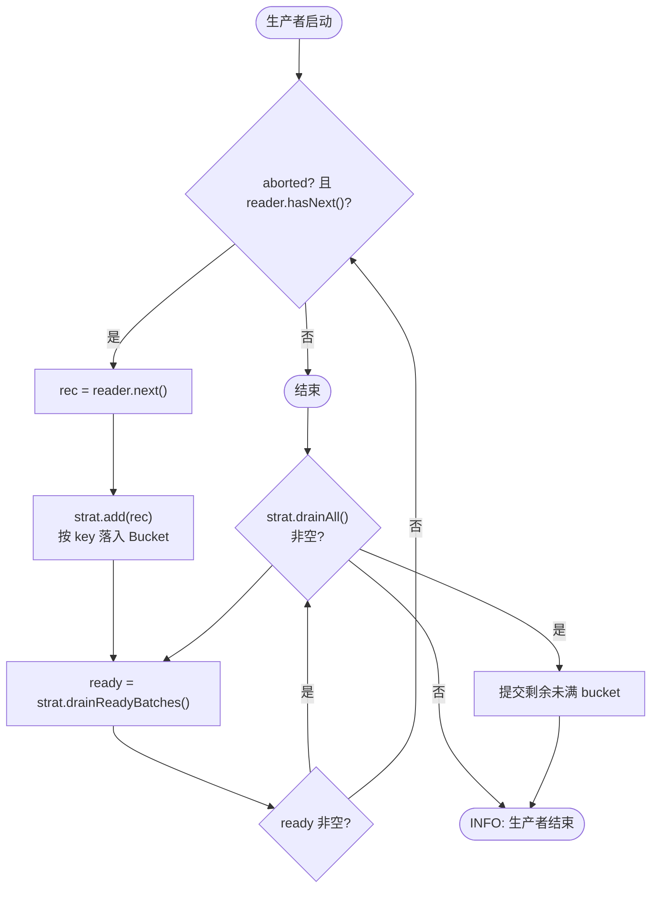

其余（Semaphore 名额、BatchTask 调用/分流/归还、PartWriter、OutputMerger、PipelineStats）**一行不改**。

### 15.4 行为保证（硬指标）

1. **单组保证**：每次 `BatchProcessor.process()` 收到的 batch 只含同一个 key。
2. **大组自动切片**：组记录数 > `batchSize` → 拆成多个单组整批，每批仍单组。
3. **批次长度不超 `batchSize`**：切片由策略内部完成，不依赖调用方的取批节奏。
4. **EOF 不丢数据**：未满 bucket 在 reader 耗尽时兜底 flush（否则尾批静默丢失）。
5. **默认行为**：未配置 `groupBy` 时，框架使用 `CountBatchingStrategy` 按数量攒批，每满 batchSize 提交一批。

`BatchTask` 的 `size == batch.size()` 顺序校验天然成立（每个桶 flush 出的仍是 `List<T>`，顺序保持），落盘/合并逻辑零改动。

### 15.5 基数约束（关键，决定复杂度）

`GroupBatchingStrategy` 为每个不同 key 在内存保留一个 bucket，各桶合计 ≤ `组数 × (batchSize-1)` 条；
再叠加在途批次 `(N+B) × batchSize`，两者都与输入总量无关。

| 分组基数 | 可行性 | 措施 |
|---|---|---|
| 低基数（≤10，用户场景：按租户/地区/固定业务线） | ✅ 直接做 | 无需桶上限，实现极轻 |
| 中/高基数（万级~无限，如按用户 ID） | ⚠️ 内存爆炸 | 需加"桶上限 + LRU 淘汰"（未来增强，非当前范围） |

**本设计面向低基数**。中高基数场景应改用**外部分文件预处理**（按 key 落不同文件后各自跑流水线），不要靠本能力——本能力不适合高基数。这与 §14.7"动态分区"不同：动态分区是要把数据拆出成千上万个文件（需分区治理、路径消毒、跨批 key 合并），而本能力是固定的少数几组、每组仍是一次普通批处理。

### 15.6 边界处理

- **key 为 `null`**：归入一个独立的 "null bucket"（多占一个桶，低基数下仍安全）。
  实现上遍历用迭代器 `remove()`，不需要区分"没找到"与"key 恰好是 null"。
- **一次取到多个就绪批次**：按 `LinkedHashMap` 插入序遍历所有攒满的桶，
  每个桶切成若干个长度恰为 `batchSize` 的批次，余量留在桶里等下次或 EOF。
- **分组键提取不抛受检异常**：`GroupKeyExtractor.extract` 只做取字段/计算，
  与 `RoutingProcessor.channelOf` 契约一致；实现若涉及 IO 请自行包装为运行时异常。

### 15.7 参数表（已实现）

| 参数 | 类型 | 默认值 | 必填 | 说明 |
|---|---|---|---|---|
| `groupExtractor` | `GroupKeyExtractor<T,K>` | null | | 按字段分组批处理（opt-in）；null = 关闭，走原计数批处理 |

派生影响：`batchSize` 在分组模式下含义变为"每桶 flush 阈值"，全局并发上限 `M = N + B` 不变。

### 15.8 改动范围声明

分组能力以内置策略的形式落在**成批层**，是 opt-in 的最小侵入扩展：`BatchingStrategy` 接口 + 两个实现，
`produce()` 只替换攒批段。不配置 `groupBy` 时行为不变，所有 SPI 契约不变；编排、背压、落盘、合并、统计
均不受影响（见 §3.2、§4.2，以及 `agents.md` §10 的编码规约）。

